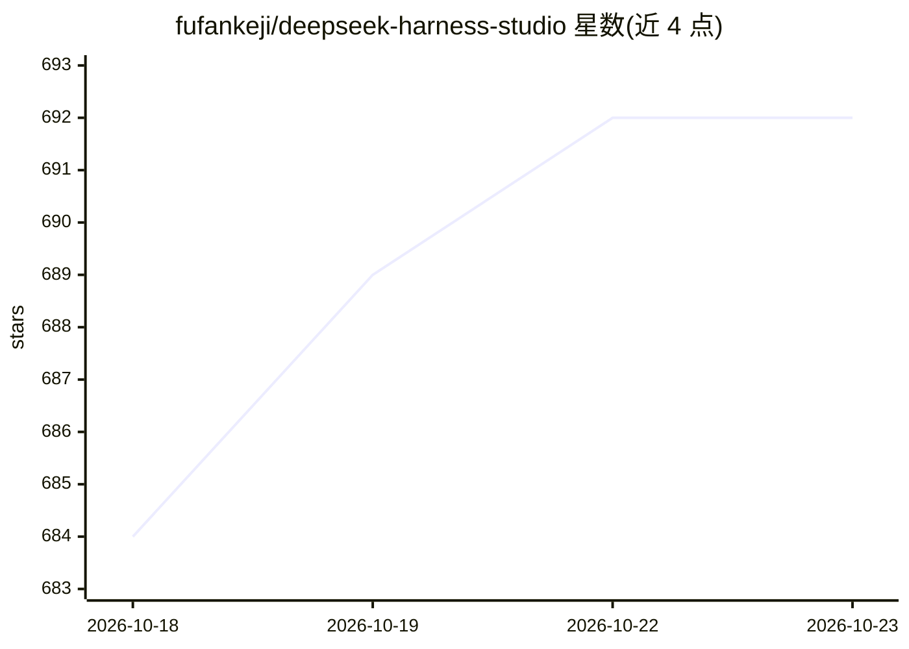

# fufankeji/deepseek-harness-studio

⭐ 692 · TypeScript · MIT · 推送 2026-09-01 · [GitHub](https://github.com/fufankeji/deepseek-harness-studio) · [官网](https://www.beyondata.com/) · 组织维护 · 中文 README

**DeepSeek Harness 的零代码 Electron 桌面客户端，含插件/Preset/应用市场**

基于 Electron 的桌面应用，由桌面主进程启动并管理本地 dsh web 服务，承载 DeepSeek Harness 的 Web 工作区。功能覆盖 Workspace 与会话管理、长会话目录、插件发现与可信安装（含 Agent 自然语言筛选插件）、Preset 广场（七套内置工作流）、应用中心（内置 FF–LLM Wiki 企业知识库）、多模型接入（DeepSeek、Ollama、vLLM、SGLang 及 OpenAI-compatible）与视觉增强。桌面安装包仅经 GitHub Releases 发布 macOS arm64 预览 ZIP 与 Windows x64 安装程序，当前为开发预览版，macOS 包未经公证需执行 xattr 命令后使用。

## 筛选速览

| 维度 | 判定 | 备注 |
|---|---|---|
| AI 角色 | `ai-ecosystem` | LLM/agent 周边工具 |
| 许可风险 | `permissive` | MIT |
| 部署形态 | `desktop` | 安装包/桌面程序 |
| 模型依赖 | local-ok | 支持本地模型 |
| 硬件要求 | — | 无带数字的原话,不猜 |
| 安装摩擦 | `medium` | 含编译或系统依赖之一 |
| 成熟度 | `idea` | |

## 能力要点

- 插件发现/插件中心/Preset 广场/应用中心四级扩展体系，含安装校验与事务回滚
- 自然语言描述需求，由 Agent 从公开 dsh-plugin 目录筛选候选插件
- 通过 OpenAI-compatible 接口连接 Ollama、vLLM、SGLang 等本地模型服务
- 内置 FF–LLM Wiki 企业知识库应用，提供文档解析、知识图谱与可追溯问答

## 适用场景

- 不用命令行即可安装、启停和管理 DeepSeek Harness 插件与 Preset
- 通过桌面端连接本地 Ollama/vLLM/SGLang 服务运行模型
- 用内置 Preset 完成报表生成、演示文稿、内容卡片等任务
- 在企业内构建带来源引用的本地知识库问答

## 场景标签

`文档问答` · 领域:知识与检索

## 证据(README 行号)

> L66: DeepSeek Harness Studio 使用 Electron 承载 DeepSeek Harness 的 Web 工作区，并由桌面主进程启动和管理本地 `dsh web` 服务。这个仓库提供完整源码开发环境，使用者可以从
> L46: |**多模型与本地推理**|配置 DeepSeek 与其他兼容提供方，或从一级入口连接 Ollama、vLLM、SGLang 和自定义 OpenAI-compatible 服务。|
> L268: Studio 已支持通过标准 OpenAI-compatible 接口接入本机或局域网中的模型服务。用户负责先启动推理服务并准备模型；Studio 不会自动下载模型、占用额外磁盘部署权重，也不会替用户管理 GPU 运行参数。

## 星数曲线

2026-10-18 684 → 2026-10-23 692（+8）

---
*卡片 v1 · prompt 1.4 · 生成 2026-10-21 · 置信度 mid · 依据 README sha `0e521bf2038e` · [字段定义](../../DATASET.md)*
