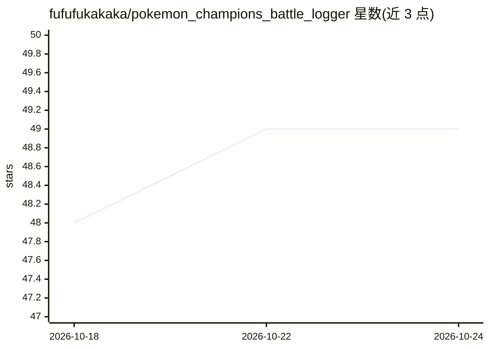

# fufufukakaka/pokemon_champions_battle_logger

⭐ 49 · NOASSERTION · 推送 2026-10-08 · [GitHub](https://github.com/fufufukakaka/pokemon_champions_battle_logger) · [官网](https://fufufukakaka.github.io/pokemon_champions_battle_logger/) · 个人维护

**宝可梦对战自动记录分析工具：直播/录像识别对战数据**

面向 Pokémon Champions 玩家的对战数据工具：通过 OBS 虚拟摄像头读取直播画面实时记录回合、HP 与场上宝可蒙，或从 YouTube URL/本地录像（含手机横屏录像）自动检测对战、识别宝可蒙、解析技能与胜负。支持单打/双打，提供胜率、选出、KO 统计的分析仪表盘，以及调用 Gemini/OpenAI/Anthropic API 的 AI 对局复盘（需自备 API key）。对战数据保存在本地，个人非商用免费，采用专有许可。提供 Windows/macOS/Linux 安装包，安装后自动在浏览器打开 127.0.0.1:8000 使用。

## 筛选速览

| 维度 | 判定 | 备注 |
|---|---|---|
| AI 角色 | `ai-native` | 本体是模型或模型工具 |
| 许可风险 | `none` | NOASSERTION |
| 部署形态 | `desktop` | 安装包/桌面程序 |
| 模型依赖 | — | README 未给出锁定关系 |
| 硬件要求 | — | 无带数字的原话,不猜 |
| 安装摩擦 | `low` | 无编译、无系统依赖或容器化 |
| 成熟度 | — | 结构信号不足 |

## 能力要点

- 直播画面（OBS 虚拟摄像头）与录像（YouTube/本地文件）两种输入的自动识别
- 单打/双打的对战日志、选出与对方队伍统计
- 胜率/选出/KO 统计与对局详情的分析仪表盘
- Gemini/OpenAI/Anthropic API 的 AI 对局复盘对话

## 适用场景

- 对战直播中实时记录回合与宝可蒙动态
- 从录像或手机录屏批量解析历史对局并复盘
- 查看自己的胜率、选出手与常见对手构筑统计

## 场景标签

`目标检测` `数据分析` · 领域:效率与自动化

## 证据(README 行号)

> L15: - **Live Scan** — OBS Virtual Camera の映像を読み取り、対戦中にターン・HP・場のポケモンを記録します
> L16: - **録画解析** — YouTube URL またはローカル動画ファイルから、バトル検出・ポケモン認識・技解析・勝敗判定を行います。Android / iPhoneで直接録画した横長動画も、解像度と画面比率を自動判定して解析で
> L20: - **AI試合振り返り** — 対戦ログ、採用統計、相性、ダメージ計算、局面解析を参照しながら、Gemini / OpenAI / Anthropic と会話して一戦を振り返れます。利用するプロバイダーのAPIキーが必要で、AP

## 星数曲线

2026-10-18 48 → 2026-10-24 49（+1）

---
*卡片 v1 · prompt 1.4 · 生成 2026-10-24 · 置信度 high · 依据 README sha `e6daf11efbb0` · [字段定义](../../DATASET.md)*
