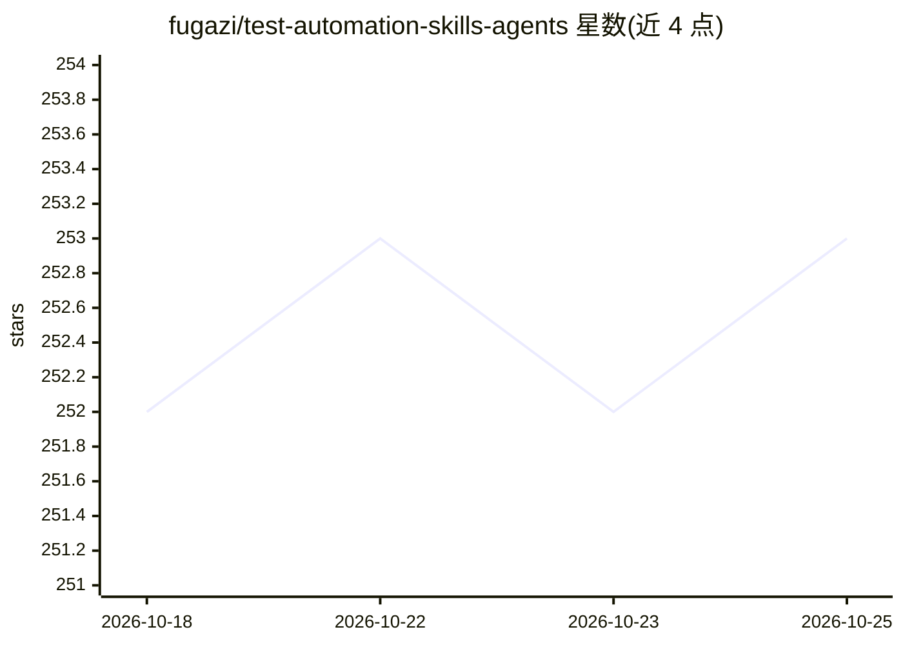

# fugazi/test-automation-skills-agents

⭐ 255 · Java · MIT · 推送 2026-10-21 · [GitHub](https://github.com/fugazi/test-automation-skills-agents) · 个人维护

**面向 QA 自动化工程师的工具无关 AI agents/技能/规范库**

一套可复制嵌入真实测试项目的文档型知识库，包含 7 个专职 QA agent 定义（编排、Playwright 规划/生成/修复、API/Selenium/重构专家）、编码规范 instructions 与 10 个可复用技能（含 SKILL.md 与参考/脚本/模板资源），覆盖 UI/API/E2E 测试、WCAG 2.2 AA 无障碍、flaky 测试排查与 ISTQB 测试计划。设计上工具无关：内容可接入 GitHub Copilot、Claude、Cursor、Windsurf 等 AI 助手；仓库本身无构建/测试系统，仅有零依赖的结构 lint 在 CI 中运行。

## 筛选速览

| 维度 | 判定 | 备注 |
|---|---|---|
| AI 角色 | `ai-knowledge` | 知识聚合/清单类 |
| 许可风险 | `permissive` | MIT |
| 部署形态 | `library` | 以包/库形式分发 |
| 模型依赖 | — | README 未给出锁定关系 |
| 硬件要求 | — | 无带数字的原话,不猜 |
| 安装摩擦 | `low` | 无编译、无系统依赖或容器化 |
| 成熟度 | — | 结构信号不足 |

## 能力要点

- 7 个专职 agent + 10 个可复用技能（SKILL.md 格式）
- 工具无关设计，支持 Copilot/Claude/Cursor/Windsurf 等接入
- 覆盖 Playwright/Selenium 模式、WCAG 2.2 AA 无障碍、ISTQB 测试计划
- 技能支持渐进式三级加载（描述→正文→资源）

## 适用场景

- 把 QA 自动化 agent 和规范复制进测试项目，让 AI 助手协助写测试
- 团队跨 Copilot/Claude/Cursor 工具统一测试编码规范
- 让 AI agent 排查和修复 CI 中不稳定的 flaky 测试

## 场景标签

`编码 Agent` · 领域:编码与开发

## 证据(README 行号)

> L5: A practical library of **agents**, **instructions**, and **skills** designed specifically for QA Automation Engineer
> L19: > Important: This repository is a **documentation/knowledge base** — no build or test system. The only validation i
> L38: This repo is a **catalog**. Choose the integration style for your tool.

## 星数曲线

2026-10-18 252 → 2026-10-25 253（+1）

---
*卡片 v1 · prompt 1.4 · 生成 2026-10-22 · 置信度 high · 依据 README sha `3ff1e57012ef` · [字段定义](../../DATASET.md)*
