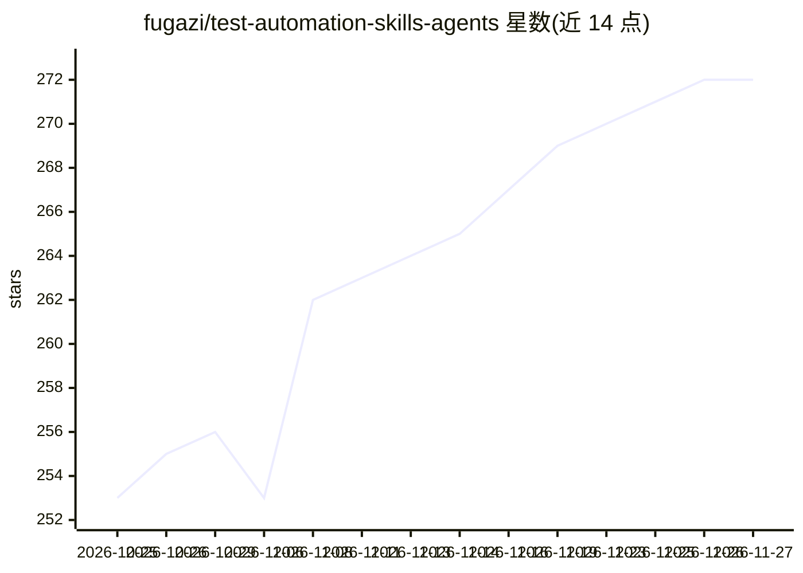

# fugazi/test-automation-skills-agents

⭐ 272 · Java · MIT · 推送 2026-11-17 · [GitHub](https://github.com/fugazi/test-automation-skills-agents) · 个人维护

**面向 QA 自动化工程师的 AI agent/技能/指令知识库**

工具无关（tool-agnostic）的 QA 自动化知识库，内容为 Markdown 格式的 agents、instructions、skills 三类资产：agents 定义角色与边界（7 个专用 QA agent），instructions 是跨领域规则（定位器策略、等待规范、WCAG 2.2 AA、ISTQB 测试计划等），skills 为可复用工作流与模板（10 个技能，覆盖 Playwright、Selenium、API 测试等）。README 明确声明这是文档/知识库，无构建或测试系统，仅有无依赖的结构化 linter 校验。集成方式包括复制到 .github/*、git submodule、Claude Code 插件市场订阅及 skills.sh 安装。

## 筛选速览

| 维度 | 判定 | 备注 |
|---|---|---|
| AI 角色 | `ai-knowledge` | 知识聚合/清单类 |
| 许可风险 | `permissive` | MIT |
| 部署形态 | `library` | 以包/库形式分发 |
| 模型依赖 | — | README 未给出锁定关系 |
| 硬件要求 | — | 无带数字的原话,不猜 |
| 安装摩擦 | `low` | 无编译、无系统依赖或容器化 |
| 成熟度 | — | 结构信号不足 |

## 能力要点

- 7 个专用 QA agent 与 10 个可复用技能
- 三类资产：agents/persona、instructions 规则、skills 工作流+脚本模板
- 四种集成方式：.github/* 复制、git submodule、Claude Code 插件市场、skills.sh

## 适用场景

- 把 Playwright/Selenium 测试规范嵌入团队的 AI 编码助手
- 用 AI agent 排查并修复 flaky 测试
- 生成符合 ISTQB 对齐的测试计划与无障碍测试

## 场景标签

`编码 Agent` · 领域:编码与开发

## 证据(README 行号)

> L5: A practical library of **agents**, **instructions**, and **skills** designed specifically for QA Automation Engineer
> L19: > Important: This repository is a **documentation/knowledge base** — no build or test system. The only validation i

## 星数曲线

2026-10-25 253 → 2026-11-27 272（+19）

---
*卡片 v1 · prompt 1.4 · 生成 2026-11-25 · 置信度 high · 依据 README sha `70c2bfb55fcf` · [字段定义](../../DATASET.md)*
