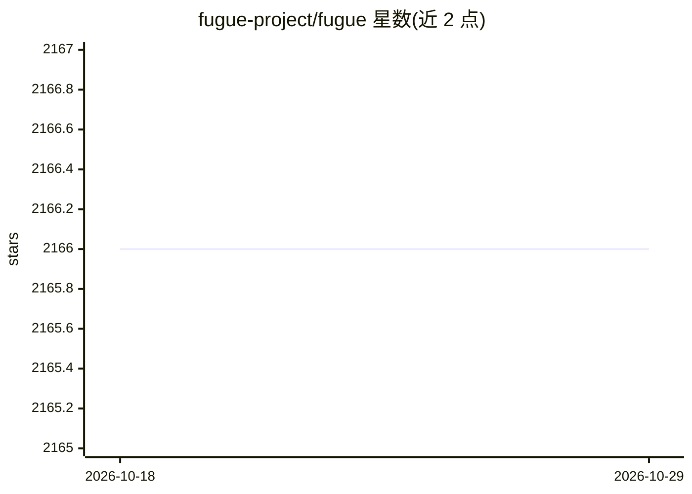

# fugue-project/fugue

⭐ 2,166 · Python · Apache-2.0 · 推送 2026-05-19 · [GitHub](https://github.com/fugue-project/fugue) · [官网](https://fugue-tutorials.readthedocs.io/) · 组织维护

**分布式计算统一接口：Python/Pandas/SQL 代码在 Spark/Dask/Ray 上运行**

面向数据从业者的分布式计算抽象层库：提供 transform() 等 API 函数与 FugueSQL（可在 SQL 中调用 Python 函数），使 Python、Pandas、Polars 与 SQL 代码在 Pandas、Spark、Dask、Ray 等执行引擎间切换而无需重写。通过 pip/conda 安装，提供 spark/dask/ray/duckdb/polars 等安装扩展；已有 Spark 或 DuckDB 时可自动复用。附带 Jupyter Notebook 扩展（%%fsql cell magic）与 Docker 教程镜像。限制：0.9.0+ 使用 FugueSQL 需额外安装 sql 扩展。

## 筛选速览

| 维度 | 判定 | 备注 |
|---|---|---|
| AI 角色 | `ai-ecosystem` | LLM/agent 周边工具 |
| 许可风险 | `permissive` | Apache-2.0 |
| 部署形态 | `self-host` | docker 或自建部署 |
| 模型依赖 | — | README 未给出锁定关系 |
| 硬件要求 | — | 无带数字的原话,不猜 |
| 安装摩擦 | `low` | 无编译、无系统依赖或容器化 |
| 成熟度 | — | 结构信号不足 |

## 能力要点

- transform() 将 Pandas/Python 函数带到 Spark/Dask/Ray 执行
- FugueSQL 可在 SQL 工作流中调用 Python 定义的函数
- 支持 Pandas/Spark/Dask/Ray/DuckDB/Ibis 等后端，通过 extras 按需安装
- 提供 %%fsql Jupyter 单元魔法扩展与语法高亮

## 适用场景

- 把现有 Pandas 代码并行化到 Spark 或 Ray 且少改动
- 用 SQL 定义端到端数据工作流并可切换执行引擎
- 在本地与分布式执行之间来回切换验证结果

## 场景标签

 · 领域:数据工程/分布式计算

## 证据(README 行号)

> L14: **Fugue is a unified interface for distributed computing that lets users execute Python, Pandas, and SQL code on Sp
> L25: The Fugue API is a collection of functions that are capable of running on Pandas, Spark, Dask, and Ray. The simples

## 星数曲线

2026-10-18 2,166 → 2026-10-29 2,166（+0）

---
*卡片 v1 · prompt 1.4 · 生成 2026-10-21 · 置信度 low · 依据 README sha `67268304b77b` · [字段定义](../../DATASET.md)*
