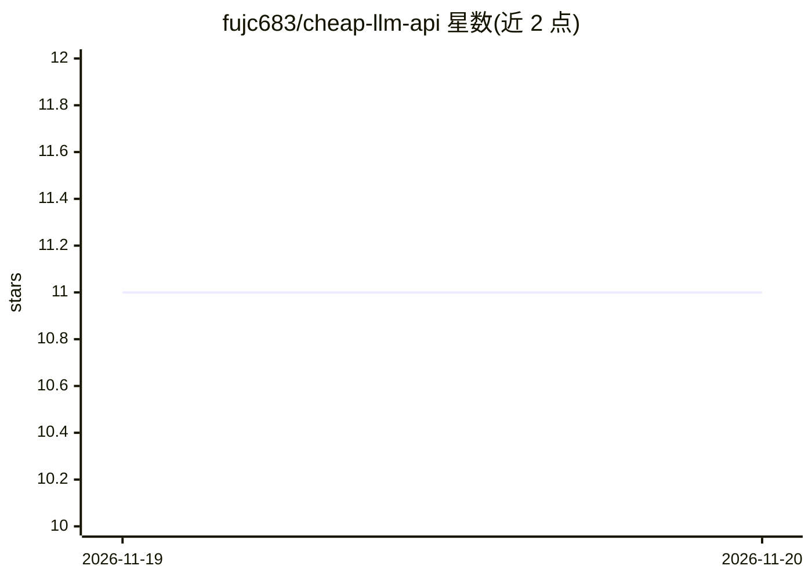

# fujc683/cheap-llm-api

⭐ 11 · NOASSERTION · 推送 2026-11-18 · [GitHub](https://github.com/fujc683/cheap-llm-api) · [官网](https://gola.apimart.ai/k-5qbxtS) · 个人维护

**APIMart 平台 LLM 价格排名清单与两级路由省钱模式**

以 CC BY 4.0 许可发布的 APIMart 平台模型价格清单：按每百万 token 价格对 DeepSeek、Qwen 等模型排序，标注各自适用场景（分类、闲聊、工具调用、推理等），并附四条成本优化方法与一个两级路由代码示例（低价模型先行、低置信度时升级到高价模型），给出典型 80/20 分流下约 70% 的账单降幅估算及真实工作负载月成本表。

## 筛选速览

| 维度 | 判定 | 备注 |
|---|---|---|
| AI 角色 | `ai-knowledge` | 知识聚合/清单类 |
| 许可风险 | `none` | NOASSERTION |
| 部署形态 | `None` |  |
| 模型依赖 | — | README 未给出锁定关系 |
| 硬件要求 | — | 无带数字的原话,不猜 |
| 安装摩擦 | `low` | 无编译、无系统依赖或容器化 |
| 成熟度 | — | 结构信号不足 |

## 能力要点

- 按每百万 token 输入/输出价格排序的模型清单
- 两级路由代码示例：低价模型先行、按置信度升级
- 前缀缓存、推理预算、批量调用等成本优化方法
- 真实工作负载的月成本估算表

## 适用场景

- 在 APIMart 选模型前比价
- 为分类/抽取类批量任务挑选低价模型
- 参考两级路由模式控制 LLM 调用账单

## 场景标签

`精选清单` · 领域:学习与行业

## 证据(README 行号)

> L1: # Cheap LLM API — price per million tokens, ranked
> L3: > Every LLM on APIMart ranked by cost, plus a two-tier routing pattern that cuts bills ~70%.
> L5: Awesome License: CC BY 4.0

## 星数曲线

2026-11-19 11 → 2026-11-20 11（+0）

---
*卡片 v1 · prompt 1.4 · 生成 2026-11-19 · 置信度 high · 依据 README sha `1b1aa033615b` · [字段定义](../../DATASET.md)*
