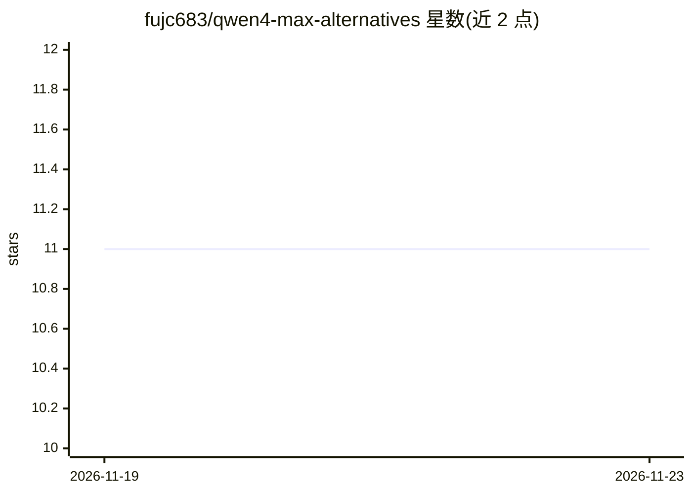

# fujc683/qwen4-max-alternatives

⭐ 11 · NOASSERTION · 推送 2026-11-18 · [GitHub](https://github.com/fujc683/qwen4-max-alternatives) · [官网](https://gola.apimart.ai/k-IF3cwI) · 个人维护

**面向开发者的 Qwen4/DeepSeek 模型选型对比清单**

一份以对比表组织的模型选型清单，按中文推理、成本、长上下文、高吞吐分类等需求列出 Qwen4 Max、Qwen3.8 Max 与 DeepSeek V3.2 的适配建议，附每百万 token 的输入/输出价格、推理轨迹支持、中文质量与成本效率对照表，并说明切换成本（同一 endpoint、仅改模型名）。内容以 CC BY 4.0 许可发布，并链接 APIMart 的 API key 获取渠道。

## 筛选速览

| 维度 | 判定 | 备注 |
|---|---|---|
| AI 角色 | `ai-knowledge` | 知识聚合/清单类 |
| 许可风险 | `none` | NOASSERTION |
| 部署形态 | `None` |  |
| 模型依赖 | — | README 未给出锁定关系 |
| 硬件要求 | — | 无带数字的原话,不猜 |
| 安装摩擦 | `low` | 无编译、无系统依赖或容器化 |
| 成熟度 | — | 结构信号不足 |

## 能力要点

- 按需求场景（中文推理/最低成本/长上下文）给出模型选择表
- 三模型每百万 token 输入/输出价格对照
- 同一 endpoint 与 payload 结构，切换仅需改模型名

## 适用场景

- 在 Qwen4 Max 与 DeepSeek V3.2 之间按预算选型
- 高吞吐分类任务评估更低价的模型选项
- 中文推理任务选择合适模型

## 场景标签

`精选清单` · 领域:学习与行业

## 证据(README 行号)

> L1: # Qwen4 Max Alternatives — what to pick and when
> L13: ## What to compare
> L15: |Need|Pick|

## 星数曲线

2026-11-19 11 → 2026-11-23 11（+0）

---
*卡片 v1 · prompt 1.4 · 生成 2026-11-19 · 置信度 high · 依据 README sha `c4ed5ba9c028` · [字段定义](../../DATASET.md)*
