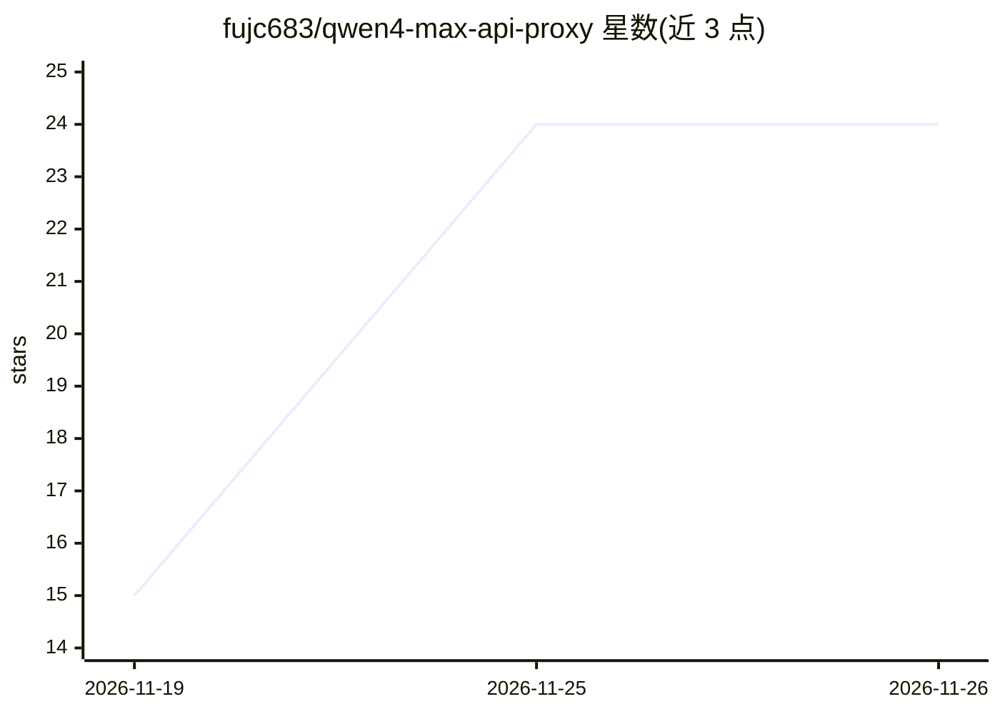

# fujc683/qwen4-max-api-proxy

⭐ 24 · NOASSERTION · 推送 2026-11-18 · [GitHub](https://github.com/fujc683/qwen4-max-api-proxy) · [官网](https://gola.apimart.ai/k-EatwtP) · 个人维护 · 中文 README

**给国内用户的 Qwen4 Max 中转 API：支付宝付款、一把 key**

该仓库是 APIMart 中转 API 的介绍页：同一把 key 通过 OpenAI 兼容端点调用 Qwen4 Max 及多个文本、图像、视频模型，支付支持支付宝/微信/银行卡，提供国内发票与统一按 token 计费余额。README 以对比表说明中转在支付、网络、密钥与账单方面与直连厂商的差异，给出 curl 调用示例与异步任务、流式输出、失败退款、重试等使用说明。仓库本身无可安装代码，服务为托管形式。

## 筛选速览

| 维度 | 判定 | 备注 |
|---|---|---|
| AI 角色 | `ai-ecosystem` | LLM/agent 周边工具 |
| 许可风险 | `none` | NOASSERTION |
| 部署形态 | `None` |  |
| 模型依赖 | — | README 未给出锁定关系 |
| 硬件要求 | — | 无带数字的原话,不猜 |
| 安装摩擦 | `low` | 无编译、无系统依赖或容器化 |
| 成熟度 | — | 结构信号不足 |

## 能力要点

- OpenAI 兼容端点，改 base_url 与 model 即可接入
- 一把 key 调用文本、图像、视频多类模型
- 支付宝/微信/银行卡支付并支持国内发票
- 图像/视频为异步 task_id+轮询，失败任务自动退款

## 适用场景

- 没有海外信用卡时调用 Qwen4 Max 等 API
- 用一把 key 在多个模型间切换降低密钥管理成本
- 统一按 token 计费并开具国内发票

## 场景标签

`模型网关` · 领域:Agent 开发

## 证据(README 行号)

> L26: curl -X POST https://api.apimart.ai/v1/chat/completions \
> L32: OpenAI-compatible: change `base_url` and `model`, keep the rest.

## 星数曲线

2026-11-19 15 → 2026-11-26 24（+9）

---
*卡片 v1 · prompt 1.4 · 生成 2026-11-19 · 置信度 high · 依据 README sha `83cf53c6a6c6` · [字段定义](../../DATASET.md)*
