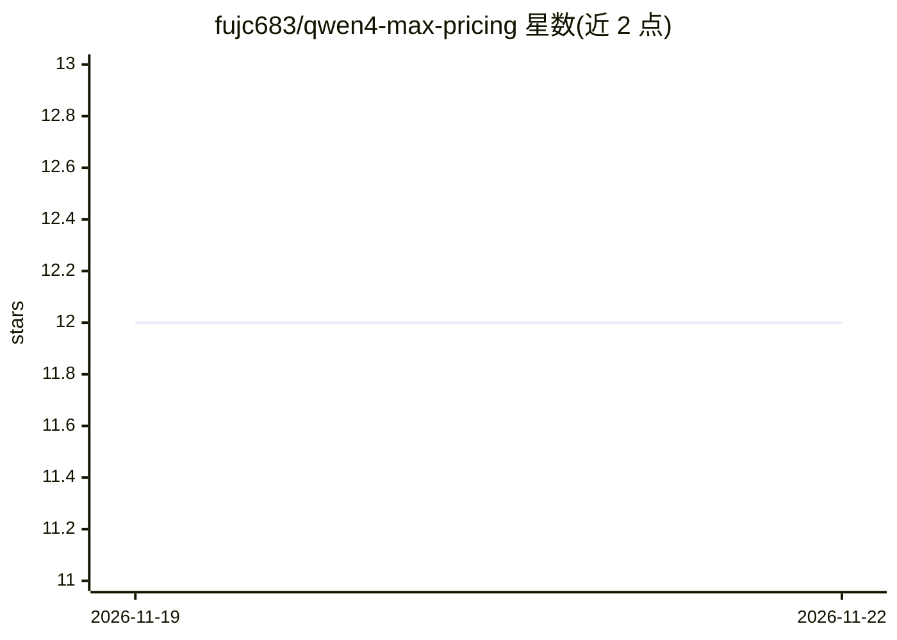

# fujc683/qwen4-max-pricing

⭐ 12 · NOASSERTION · 推送 2026-11-18 · [GitHub](https://github.com/fujc683/qwen4-max-pricing) · [官网](https://gola.apimart.ai/k-ldlt5A) · 个人维护

**Qwen4 Max 模型按百万 token 的定价与用量成本测算页**

一份以价格表为主体的资料页：列出 Qwen4 Max 每百万 token 的输入/输出单价，给出四类任务（工单分类、PDF 摘要、Agent 运行、代码审查）的 token 用量与成本估算表、与 Qwen3.8 Max/DeepSeek V3.2 等模型的单价对比表，以及按月用量的预算梯度表，并说明推理 token 计费规则与账本增长因素。内容无代码与安装步骤，附 APIMart 使用链接，按 CC BY 4.0 许可发布。

## 筛选速览

| 维度 | 判定 | 备注 |
|---|---|---|
| AI 角色 | `ai-knowledge` | 知识聚合/清单类 |
| 许可风险 | `none` | NOASSERTION |
| 部署形态 | `None` |  |
| 模型依赖 | — | README 未给出锁定关系 |
| 硬件要求 | — | 无带数字的原话,不猜 |
| 安装摩擦 | `low` | 无编译、无系统依赖或容器化 |
| 成熟度 | — | 结构信号不足 |

## 能力要点

- 每百万 token 的输入 $1.4286 / 输出 $4.2857 单价表
- 四类典型任务的 token 用量与成本估算表
- 与 Qwen3.8 Max、DeepSeek V3.2 等模型的单价对比
- 按月 token 量级的三档预算估算

## 适用场景

- 接入前估算任务调用 Qwen4 Max 的花费
- 对比不同模型每百万 token 的单价
- 按月用量做 API 预算规划

## 场景标签

 · 领域:LLM 基础设施/定价信息

## 证据(README 行号)

> L1: # Qwen4 Max Pricing — what a task actually costs
> L24: |Task|Input tokens|Output tokens|Cost|

## 星数曲线

2026-11-19 12 → 2026-11-22 12（+0）

---
*卡片 v1 · prompt 1.4 · 生成 2026-11-19 · 置信度 high · 依据 README sha `ad1d77972aaa` · [字段定义](../../DATASET.md)*
