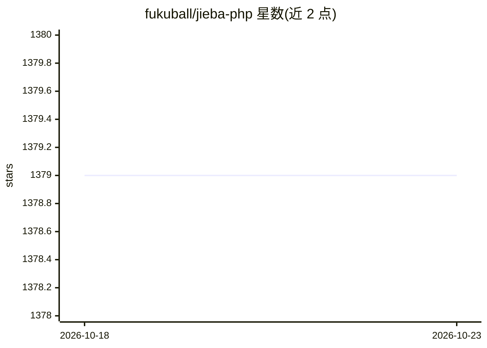

# fukuball/jieba-php

⭐ 1,379 · PHP · MIT · 推送 2025-12-16 · [GitHub](https://github.com/fukuball/jieba-php) · 个人维护 · 中文 README

**PHP 中文/CJK 分词组件，提供分词、关键词提取与词性标注**

翻译自 fxsjy/jieba 的 PHP 中文分词库，现为独立分支。提供精确、全模式、搜索引擎三种分词模式，基于 Trie 树生成 DAG、动态规划求最大概率路径、未登录词用 HMM+Viterbi 处理。支持繁体字典、自定义词典、中日韩多语言文本、TF-IDF 关键词提取、词性标注（可含 TF-IDF 分数）及返回词位置。提供 JiebaMemory 统一内存管理与缓存统计/清理机制，通过 composer 安装。README 注明 LLM 断词效果更好，本库定位为快速、便宜的方案。

## 筛选速览

| 维度 | 判定 | 备注 |
|---|---|---|
| AI 角色 | `ai-native` | 本体是模型或模型工具 |
| 许可风险 | `permissive` | MIT |
| 部署形态 | `None` |  |
| 模型依赖 | — | README 未给出锁定关系 |
| 硬件要求 | — | 无带数字的原话,不猜 |
| 安装摩擦 | `low` | 无编译、无系统依赖或容器化 |
| 成熟度 | — | 结构信号不足 |

## 能力要点

- 三种分词模式（精确/全模式/搜索引擎）
- Trie+DAG+动态规划，未登录词用 HMM（Viterbi）识别
- TF-IDF 关键词提取与词性标注（含 TF-IDF 分数）
- 繁体字典、自定义词典、CJK 多语言与内存/缓存管理

## 适用场景

- PHP 项目中对中文文本做分词以支撑搜索或文本分析
- 为搜索引擎构建倒排索引的细粒度切词
- 提取文档关键词或做词性标注

## 场景标签

 · 领域:自然语言处理

## 证据(README 行号)

> L6: "結巴"中文分詞：做最好的 PHP 中文分詞、中文斷詞組件，原始版本翻譯自 fxsjy/jieba，目前已經為一個獨立分支，請有興趣的開發者一起加入開發！若想使用 Python 版本請前往 fxsjy/jieba
> L63: - 基於 Trie 樹結構實現高效的詞圖掃描，生成句子中漢字所有可能成詞情況所構成的有向無環圖（DAG)
> L65: - 對於未登錄詞，採用了基於漢字成詞能力的 HMM 模型，使用了 Viterbi 算法

## 星数曲线

2026-10-18 1,379 → 2026-10-23 1,379（+0）

---
*卡片 v1 · prompt 1.4 · 生成 2026-10-21 · 置信度 high · 依据 README sha `c484acb86dc5` · [字段定义](../../DATASET.md)*
