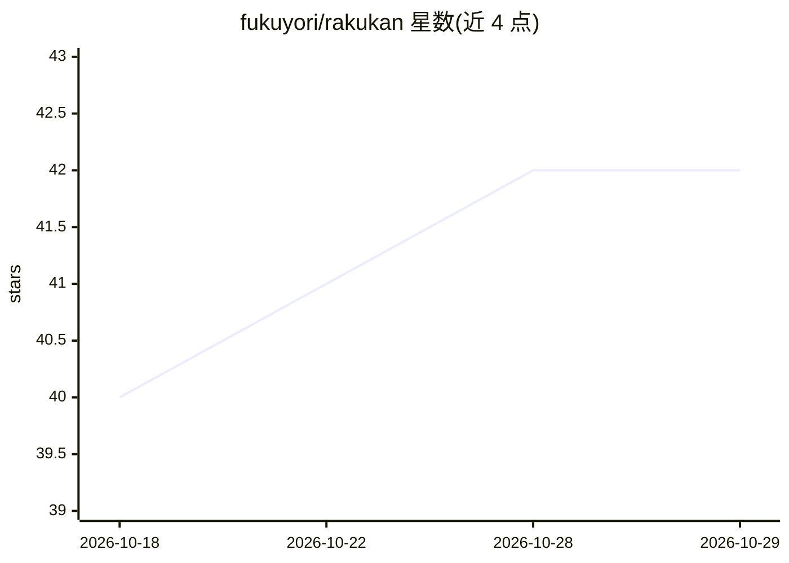

# fukuyori/rakukan

⭐ 42 · Rust · MIT · 推送 2026-10-24 · [GitHub](https://github.com/fukuyori/rakukan) · 个人维护

**用本地小型 LLM 做假名汉字变换的实验性 Windows 日语 IME**

基于 karukan 的 LLM 变换引擎与 azooKey-Windows 的 TSF 层实现的 Windows 日语输入法。将轻量本地 LLM（jinen v1/v2，Qwen3 基座，约 28-81 MB 量化模型）与 Mozc 系词典结合，提供实时变换、数字/字母保护、用户词典与学习历史、按符号分块变换等功能。架构上把 TSF DLL 与变换引擎分离为独立进程，支持 CPU/Vulkan/CUDA 后端切换。作者声明这是测试中的原型，实时变换仍有 bug，安装注册 TSF DLL 需自担风险，不推荐用于重要工作环境。通过 Releases 的 setup.exe 安装，或从 Rust/.NET 源码构建。

## 筛选速览

| 维度 | 判定 | 备注 |
|---|---|---|
| AI 角色 | `ai-enhanced` | 去掉 AI 部分产品仍成立 |
| 许可风险 | `permissive` | MIT |
| 部署形态 | `desktop` | 安装包/桌面程序 |
| 模型依赖 | — | README 未给出锁定关系 |
| 硬件要求 | — | 无带数字的原话,不猜 |
| 安装摩擦 | `high` | 编译与系统依赖俱全 |
| 成熟度 | `idea` | |

## 能力要点

- 本地小型 LLM（jinen 系列，量化约 28-81 MB）+ Mozc 系词典的假名汉字变换
- TSF DLL 与 engine-host 分进程架构，隔离 GPU/LLM 资源
- CPU / Vulkan / CUDA 三种引擎后端可配置切换，auto 模式自动回退
- 实时变换、数字字母保护、用户词典与学习历史即时反映

## 适用场景

- 在 Windows 上试用 LLM 驱动的日语假名汉字变换
- 观察实时变换与 TSF 实现的实验行为并反馈改进
- 在本地离线环境完成日语输入，不依赖云服务

## 场景标签

 · 领域:输入法/桌面工具

## 证据(README 行号)

> L10: Windows 向け日本語 IME。
> L14: rakukan は、ローカルで動く小型 LLM と Mozc 系辞書を組み合わせ、従来のかな漢字変換とは少し違う候補の出し方を試すための実験的な IME です。入力中の読みから候補を先読みするライブ変換、数字やアルファベットを壊さ
> L16: 設計上の大きな特徴は、TSF DLL と変換エンジンを別プロセスに分けていることです。Windows の入力フレームワーク側には軽いクライアントだけを置き、LLM や GPU バックエンドは `rakukan-engine-hos

## 星数曲线

2026-10-18 40 → 2026-10-29 42（+2）

---
*卡片 v1 · prompt 1.4 · 生成 2026-10-25 · 置信度 high · 依据 README sha `f957ec4fe78b` · [字段定义](../../DATASET.md)*
