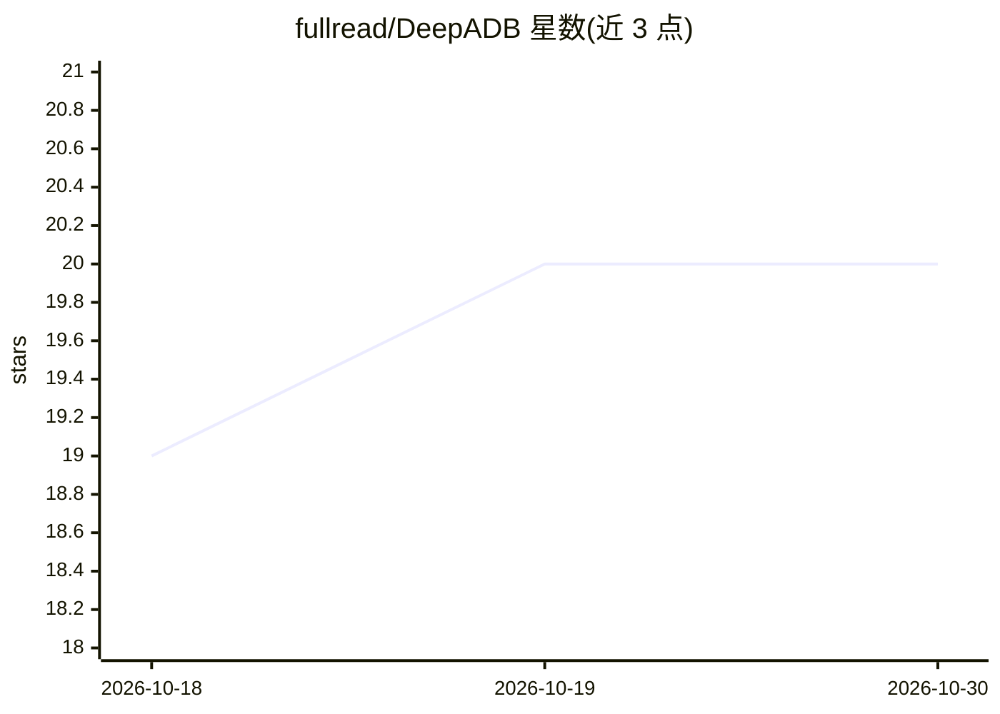

# fullread/DeepADB

⭐ 20 · TypeScript · Apache-2.0 · 推送 2026-10-23 · [GitHub](https://github.com/fullread/DeepADB) · 个人维护

**让 AI agent 通过 ADB/Termux 检查与控制 Android 设备的 MCP 服务器**

TypeScript 实现的 MCP server，向 AI agent 暴露 209 个工具、5 个资源与 4 个提示词，覆盖 UI 自动化、应用管理、日志、网络抓包、基带、固件、SELinux 与硬件诊断等 49 个模块。默认在 PC 端经 ADB（USB）桥接设备；检测到 Termux 环境时自动切换为端上直连模式，经 sh/su 本地执行，同一工具面在两种模式下注册。端上特权命令通过冻结的 16 条命令允许列表经 su 提升。v1.1.4 在 Pixel 6a / Android 16 上完成回归（604 通过 / 0 失败 / 17 环境相关跳过）。

## 筛选速览

| 维度 | 判定 | 备注 |
|---|---|---|
| AI 角色 | `ai-ecosystem` | LLM/agent 周边工具 |
| 许可风险 | `permissive` | Apache-2.0 |
| 部署形态 | `desktop` | 安装包/桌面程序 |
| 模型依赖 | — | README 未给出锁定关系 |
| 硬件要求 | — | 无带数字的原话,不猜 |
| 安装摩擦 | `low` | 无编译、无系统依赖或容器化 |
| 成熟度 | — | 结构信号不足 |

## 能力要点

- 209 个工具覆盖 UI、日志、网络抓包、基带、固件、安全等 49 个模块
- ADB 与 Termux 双模式，启动时自动检测切换
- 16 条命令允许列表经 su 的特权提升路径，允许列表冻结不可配置
- 提供 SQLite 只读检查、logcat 持久 watcher、多设备编排与插件扩展

## 适用场景

- 让 Claude Code 等 MCP 客户端直接诊断与操作连接的 Android 设备
- 在 Termux 中端上运行 AI agent 做本地设备诊断与测试
- 自动化 Android 应用测试、日志采集与崩溃分析

## 场景标签

`GUI 自动化` · 领域:效率与自动化

## 证据(README 行号)

> L8: MCP (Model Context Protocol) server for AI agents that need to inspect, control, test, and diagnose Android devices 
> L14: DeepADB runs as a local MCP server. It uses ADB by default and automatically switches to direct execution when it d

## 星数曲线

2026-10-18 19 → 2026-10-30 20（+1）

---
*卡片 v1 · prompt 1.4 · 生成 2026-10-28 · 置信度 high · 依据 README sha `dc4f1fa170a4` · [字段定义](../../DATASET.md)*
