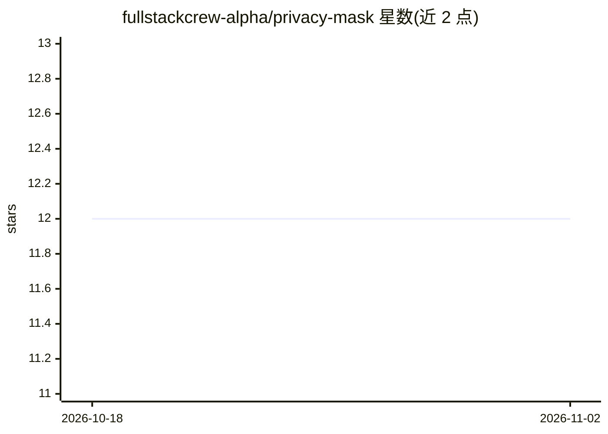

# fullstackcrew-alpha/privacy-mask

⭐ 12 · Python · MIT · 推送 2026-03-24 · [GitHub](https://github.com/fullstackcrew-alpha/privacy-mask) · [官网](https://pypi.org/project/privacy-mask/) · 组织维护 · 中文 README

**本地离线检测并遮蔽截图中敏感信息的工具**

在截图发送给 AI 编码助手之前，于本地拦截并自动遮蔽敏感内容：通过双引擎 OCR（Tesseract + RapidOCR）提取文本及位置，再用可切换的检测引擎——GLiNER 零样本 NER（默认，需安装 privacy-mask[ner]）或 47 条覆盖 15+ 国家的正则规则——识别身份证号、电话、API 密钥等 40+ 类模式，对命中区域模糊或色块填充。遵循 agentskills.io SKILL.md 标准，适配 20+ 本地 AI 编码工具（Claude Code、Cursor、OpenClaw 等），仅支持本地 agent，不适用于 Web 版 AI。100% 本地处理，不出网。

## 筛选速览

| 维度 | 判定 | 备注 |
|---|---|---|
| AI 角色 | `ai-native` | 本体是模型或模型工具 |
| 许可风险 | `permissive` | MIT |
| 部署形态 | `library` | 以包/库形式分发 |
| 模型依赖 | — | README 未给出锁定关系 |
| 硬件要求 | — | 无带数字的原话,不猜 |
| 安装摩擦 | `low` | 无编译、无系统依赖或容器化 |
| 成熟度 | — | 结构信号不足 |

## 能力要点

- GLiNER 零样本 NER 与 47 条正则规则双引擎可切换
- OCR + 行分组 + 检测 + 遮蔽的本地处理管线，数据不出机器
- 遵循 agentskills.io SKILL.md 标准，适配 20+ 本地 AI 编码工具
- 支持中国身份证、银行卡、微信/QQ 号等 15+ 国家模式与自定义规则

## 适用场景

- 把截图发给 AI 助手前自动遮蔽身份证、电话、API 密钥等敏感信息
- 满足 GDPR/HIPAA 等合规要求下在源头保护敏感数据
- 为本地运行的编码 agent 配置截图脱敏 hook

## 场景标签

`OCR` `网络安全` · 领域:学习与行业

## 证据(README 行号)

> L10: > **Your images never leave your machine.** privacy-mask intercepts screenshots before they are sent to AI services
> L116: |**NER** (default)|Zero-shot Named Entity Recognition via GLiNER. Detects person names, addresses, organizations, 
> L161: 1. **OCR** — Dual-engine: Tesseract + RapidOCR extract text with bounding boxes. Multi-strategy preprocessing (gra

## 星数曲线

2026-10-18 12 → 2026-11-02 12（+0）

---
*卡片 v1 · prompt 1.4 · 生成 2026-11-01 · 置信度 high · 依据 README sha `bbeb8e520711` · [字段定义](../../DATASET.md)*
