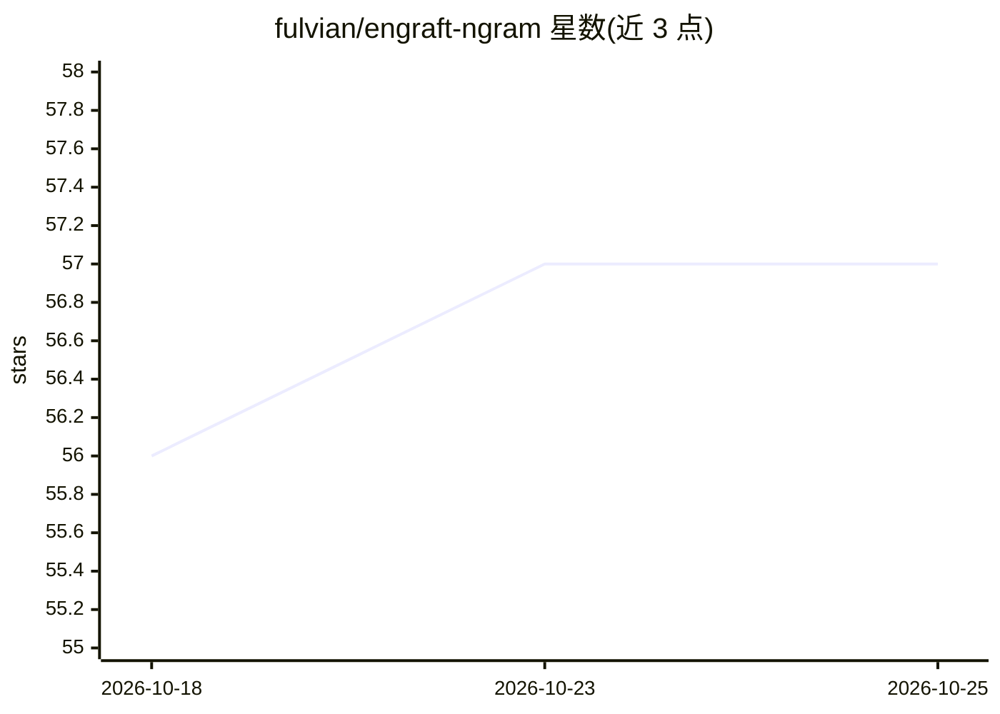

# fulvian/engraft-ngram

⭐ 57 · Python · Apache-2.0 · 推送 2026-09-30 · [GitHub](https://github.com/fulvian/engraft-ngram) · [官网](https://engraft-engram.dev) · 个人维护

**向 LLM 的 n-gram 记忆表写入事实的研究方法，不改权重**

面向带 Engram/PLE 式 n-gram 查找表的语言模型（实测于 Qwen3.8-Flash-Next，DeepSeek V4.1 Flash 为下一目标）的知识注入方法：仅训练表中的行，梯度下降生成一个小体积 .pleo 覆盖层，由 llama.cpp 分叉在读取时应用，磁盘上的 GGUF 不被修改，移除覆盖层可逐位还原模型。发布内容包括方法、下降与测量代码、引擎分叉、Quail 语料及全部结果文件。限制：事实不跨语言迁移、不替代检索、非通用模型编辑；快速执行路径与文档转语料工具未包含。

## 筛选速览

| 维度 | 判定 | 备注 |
|---|---|---|
| AI 角色 | `ai-ecosystem` | LLM/agent 周边工具 |
| 许可风险 | `permissive` | Apache-2.0 |
| 部署形态 | `None` |  |
| 模型依赖 | local-ok | 支持本地模型 |
| 硬件要求 | — | 无带数字的原话,不猜 |
| 安装摩擦 | `low` | 无编译、无系统依赖或容器化 |
| 成熟度 | `idea` | |

## 能力要点

- 仅训练 n-gram 表行，模型权重不变，覆盖层可逐位还原
- 单文件 .pleo 覆盖层，推理时不占上下文 token、无需检索器或第二模型
- 实测 100 事实覆盖层约 9 MB，在 llama.cpp GGUF 上验证
- 全部指标附带可复算的结果文件路径

## 适用场景

- 研究向特定模型注入小规模事实而不动权重
- 考察 n-gram 记忆表的容量与附带损伤
- 验证知识编辑的可移除性与跨语言行为

## 场景标签

 · 领域:LLM 研究工具/知识编辑

## 证据(README 行号)

> L14: ENGRAFT writes new facts into that table. Only rows of the table are trained; every weight of
> L19: **Scope.** The method applies to models that carry an Engram-style table. Every measurement in
> L25: descent. It is not general model editing, and it is not a replacement for retrieval. A grafted

## 星数曲线

2026-10-18 56 → 2026-10-25 57（+1）

---
*卡片 v1 · prompt 1.4 · 生成 2026-10-24 · 置信度 high · 依据 README sha `7d67a9786259` · [字段定义](../../DATASET.md)*
