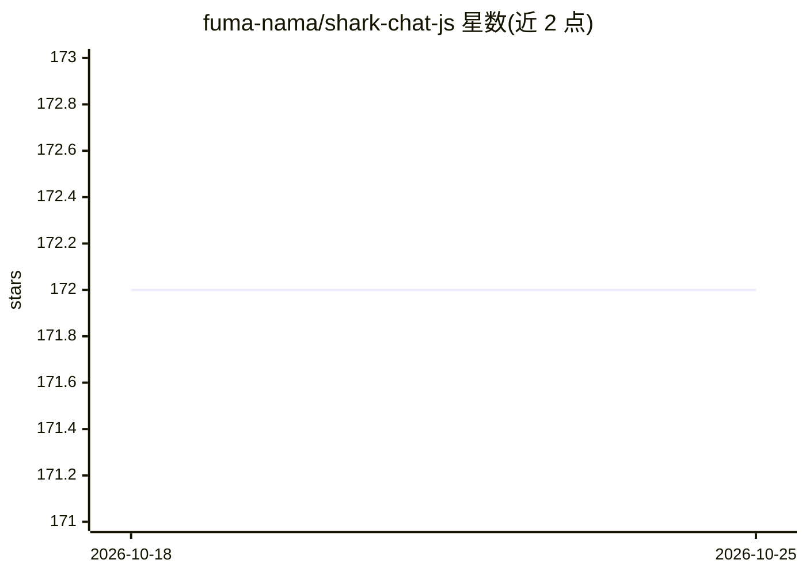

# fuma-nama/shark-chat-js

⭐ 172 · TypeScript · Apache-2.0 · 推送 2026-05-21 · [GitHub](https://github.com/fuma-nama/shark-chat-js) · [官网](https://shark-chat.vercel.app) · 个人维护

**Next.js 全栈聊天应用，内置 AI 机器人与消息写作辅助**

基于 Next.js (App Router)、tRPC、Tailwind CSS、Ably、Redis、Cloudinary 与 Drizzle ORM 构建的聊天应用，以 Turborepo monorepo 形式组织。功能覆盖群组与消息的增删改、Markdown/代码高亮/LaTeX 渲染、消息引用与链接预览、文件图片传输、私信、自定义表情与通知等。AI 部分：AI 消息写作辅助与内置 AI 聊天机器人（由 Inworld 提供支持）。本地运行需注册 Upstash、Ably、Cloudinary、Neon PostgreSQL、GitHub OAuth 等多个第三方服务并配置环境变量。

## 筛选速览

| 维度 | 判定 | 备注 |
|---|---|---|
| AI 角色 | `ai-enhanced` | 去掉 AI 部分产品仍成立 |
| 许可风险 | `permissive` | Apache-2.0 |
| 部署形态 | `None` |  |
| 模型依赖 | — | README 未给出锁定关系 |
| 硬件要求 | — | 无带数字的原话,不猜 |
| 安装摩擦 | `low` | 无编译、无系统依赖或容器化 |
| 成熟度 | — | 结构信号不足 |

## 能力要点

- 群组与消息管理（创建/更新/删除/引用/嵌入预览）
- Markdown（gfm/表格）、代码高亮与 LaTeX 消息渲染
- AI-Powered Message Writer 与 Inworld 驱动的内置 AI 聊天机器人
- 100% TypeScript，Turborepo monorepo，可部署于 Vercel

## 适用场景

- 自托管一个支持群组与私信的聊天应用
- 体验带 AI 机器人与写作辅助的聊天交互
- 作为 Next.js 全栈应用的学习或二开模板

## 场景标签

`聊天机器人` `AI 写作` · 领域:对话与助手

## 证据(README 行号)

> L23: - AI-Powered Message Writer
> L24: - Built-in AI Chatbot (Powered by Inworld)

## 星数曲线

2026-10-18 172 → 2026-10-25 172（+0）

---
*卡片 v1 · prompt 1.4 · 生成 2026-10-22 · 置信度 high · 依据 README sha `bd3cf7170f21` · [字段定义](../../DATASET.md)*
