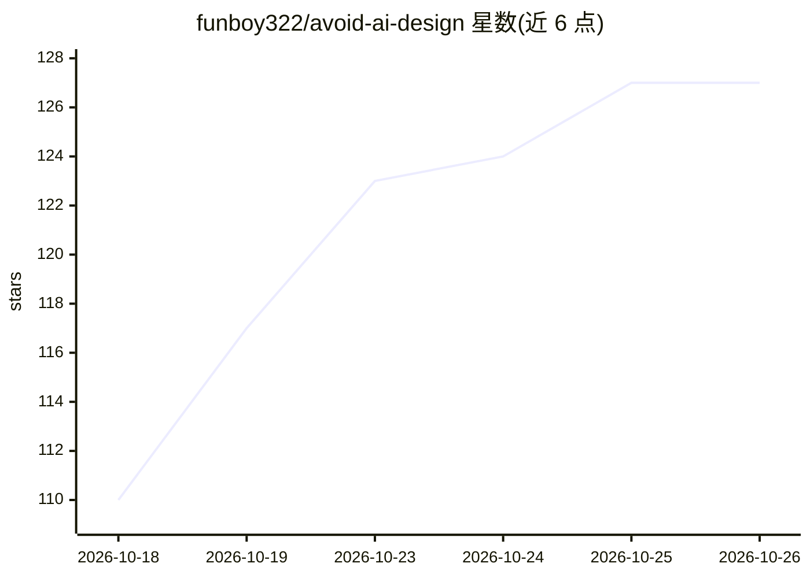

# funboy322/avoid-ai-design

⭐ 127 · JavaScript · MIT · 推送 2026-09-24 · [GitHub](https://github.com/funboy322/avoid-ai-design) · 个人维护

**审计并改写 AI 生成前端代码的 Claude Code 技能，消除 AI 设计痕迹**

以 SKILL.md 格式交付的 agent 技能：扫描 AI 生成的前端代码，按 67 条识别特征目录（含紫渐变、cream+terracotta 等二阶默认样式）标记 AI 设计痕迹，从产品本身推导设计方向后改写页面，多页项目写入 DESIGN.md 保持一致性。提供零依赖 Node 18+ 扫描脚本，可作为 CI 门禁。兼容 Claude Code、Cursor、Codex CLI 等支持 SKILL.md 格式的工具。限制：脚本仅覆盖源码可判定的部分，视觉层面需渲染截图配合。

## 筛选速览

| 维度 | 判定 | 备注 |
|---|---|---|
| AI 角色 | `ai-ecosystem` | LLM/agent 周边工具 |
| 许可风险 | `permissive` | MIT |
| 部署形态 | `library` | 以包/库形式分发 |
| 模型依赖 | — | README 未给出锁定关系 |
| 硬件要求 | — | 无带数字的原话,不猜 |
| 安装摩擦 | `low` | 无编译、无系统依赖或容器化 |
| 成熟度 | — | 结构信号不足 |

## 能力要点

- 67 条 AI 设计特征目录，按 P0/P1/P2 分级
- 零依赖扫描脚本 detect.mjs，退出码可作 CI 门禁
- rewrite 与 detect 两种模式，支持 PostToolUse 钩子实时检查
- 多页项目通过 DESIGN.md（Google 开放格式模板）维持设计一致

## 适用场景

- 把 AI 生成的落地页改得不像 AI 做的
- 在 CI 中拦截含 AI 默认样式痕迹的前端代码
- 审计他人生成的前端代码但不直接改动
- 为多页站点建立统一设计方向防止漂移

## 场景标签

`代码审查` · 领域:编码与开发

## 证据(README 行号)

> L3: **A Claude Code skill that audits AI-generated frontend code and rewrites it so it stops looking AI-generated, inclu
> L156: `avoid-ai-design` is a plain `SKILL.md` with reference files and one optional script. It needs no APIs or keys, so
> L158: - Claude Code (CLI, desktop, web, IDE extensions)

## 星数曲线

2026-10-18 110 → 2026-10-26 127（+17）

---
*卡片 v1 · prompt 1.4 · 生成 2026-10-23 · 置信度 high · 依据 README sha `7609c4b41f39` · [字段定义](../../DATASET.md)*
