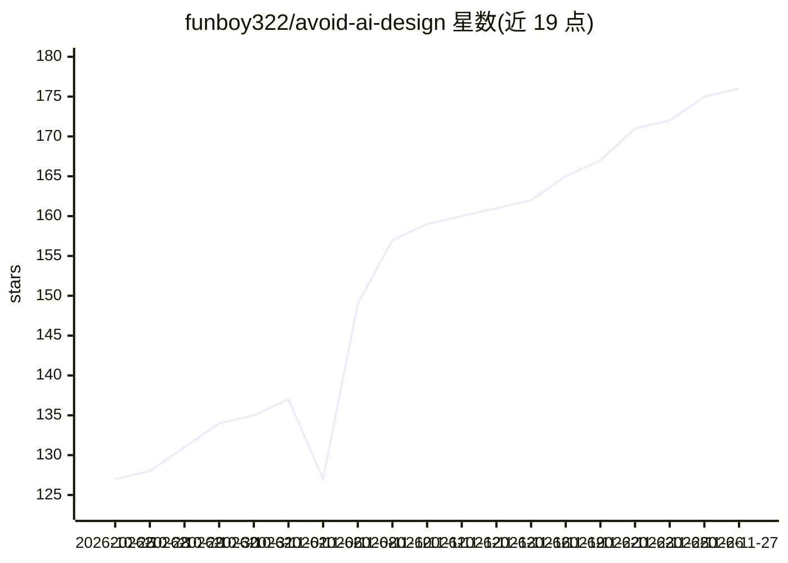

# funboy322/avoid-ai-design

⭐ 176 · JavaScript · MIT · 推送 2026-11-18 · [GitHub](https://github.com/funboy322/avoid-ai-design) · 个人维护

**审计并重写 AI 生成前端代码的 Claude Code 技能**

以 Claude Code 技能（SKILL.md）形式分发的前端代码审计与重写工具：扫描 AI 生成的界面，按 81 条 'AI 特征' 目录（含紫渐变等一级默认与 cream+terracotta 等二级默认）标记问题，再围绕产品自身重写界面，多页项目通过 DESIGN.md 保持一致性。附带零依赖的 Node 18+ 命令行扫描器 detect.mjs，输出含 P0/P1/P2 分级与堆叠数，退出码可作 CI 门禁；支持 detect/rewrite 两种模式与 PostToolUse hook 集成。

## 筛选速览

| 维度 | 判定 | 备注 |
|---|---|---|
| AI 角色 | `ai-ecosystem` | LLM/agent 周边工具 |
| 许可风险 | `permissive` | MIT |
| 部署形态 | `library` | 以包/库形式分发 |
| 模型依赖 | — | README 未给出锁定关系 |
| 硬件要求 | — | 无带数字的原话,不猜 |
| 安装摩擦 | `low` | 无编译、无系统依赖或容器化 |
| 成熟度 | — | 结构信号不足 |

## 能力要点

- 81 条 AI 设计特征目录，按 P0/P1/P2 可见度分级
- 零依赖 Node 扫描器，--json 输出，退出码 2 可作 CI 门禁
- detect/rewrite 两种模式；多页项目写 DESIGN.md 防漂移
- 支持 Claude Code/Cursor/Codex 等 agent 的技能目录约定

## 适用场景

- 检测刚生成的落地页是否带有 AI 设计特征
- 按产品自身重写界面并保持多页设计一致
- 把扫描器接入 CI，在提交前拦截模板化页面

## 场景标签

`编码 Agent` `代码审查` · 领域:编码与开发

## 证据(README 行号)

> L3: **A Claude Code skill that audits AI-generated frontend code and rewrites it so it stops looking AI-generated, inclu
> L6: SKILL.md spec
> L53: `scripts/detect.mjs` finds the code-certain tells with no model call and no dependencies (Node 18+):

## 星数曲线

2026-10-25 127 → 2026-11-27 176（+49）

---
*卡片 v1 · prompt 1.4 · 生成 2026-11-26 · 置信度 high · 依据 README sha `1f8698a7a765` · [字段定义](../../DATASET.md)*
