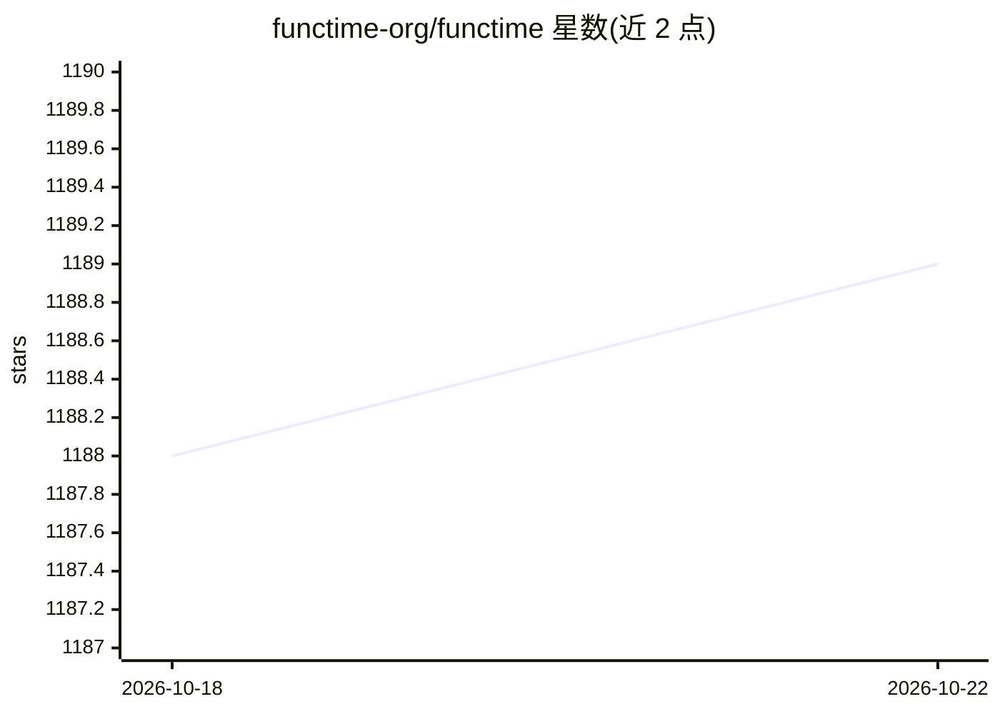

# functime-org/functime

⭐ 1,189 · Python · Apache-2.0 · 推送 2026-05-03 · [GitHub](https://github.com/functime-org/functime) · [官网](https://functime-org.github.io/functime/) · 组织维护

**面向面板数据的大规模时间序列预测与特征提取 Python 库**

基于 Polars 构建的时间序列机器学习库，提供全局预测（global forecasting）与 100+ 时间序列特征提取器，面向大规模面板数据做惰性并行计算。附带预处理（box-cox、差分）、交叉验证切分器（扩展/滑动窗口）、预测指标（MASE、SMAPE），支持外生特征、回测，并通过 FLAML 做自动滞后与超参调优。可选安装 LLM 预测分析 agent（用自然语言分析、描述、比较预测结果）。以 pip/uv 安装的 Python 库形式提供，Apache-2.0 许可。

## 筛选速览

| 维度 | 判定 | 备注 |
|---|---|---|
| AI 角色 | `ai-native` | 本体是模型或模型工具 |
| 许可风险 | `permissive` | Apache-2.0 |
| 部署形态 | `library` | 以包/库形式分发 |
| 模型依赖 | — | README 未给出锁定关系 |
| 硬件要求 | — | 无带数字的原话,不猜 |
| 安装摩擦 | `low` | 无编译、无系统依赖或容器化 |
| 成熟度 | — | 结构信号不足 |

## 能力要点

- 基于 Polars 的惰性并行时间序列特征工程，可在笔记本上处理 100,000 条时间序列
- 100+ 特征提取器，通过自定义 ts 命名空间接入 Polars Series/表达式
- 扩展/滑动窗口交叉验证、回测与 MASE/SMAPE 等预测指标
- 可选 LLM agent 分析、描述与比较预测；FLAML 自动滞后与超参调优

## 适用场景

- 在面板数据上做大规模全局时间序列预测
- 并行提取 tsfresh/Catch22 类时序特征用于建模
- 用扩展/滑动窗口对预测模型做回测与调参

## 场景标签

 · 领域:机器学习/时间序列

## 证据(README 行号)

> L11: **functime** is a powerful Python library for production-ready **global forecasting** and **time-series feature ext
> L18: - **Fast:** Forecast and extract features (e.g. tsfresh, Catch22) across 100,000 time series in seconds *on your la

## 星数曲线

2026-10-18 1,188 → 2026-10-22 1,189（+1）

---
*卡片 v1 · prompt 1.4 · 生成 2026-10-21 · 置信度 high · 依据 README sha `0b7c4e5ad2aa` · [字段定义](../../DATASET.md)*
