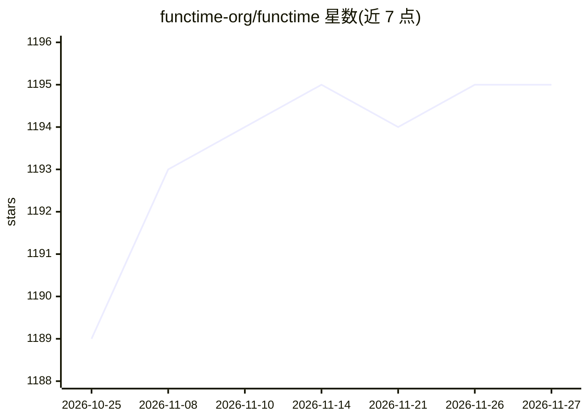

# functime-org/functime

⭐ 1,195 · Python · Apache-2.0 · 推送 2026-11-26 · [GitHub](https://github.com/functime-org/functime) · [官网](https://functime-org.github.io/functime/) · 组织维护

**面向面板数据的时间序列预测与特征提取 Python 库**

基于 Polars 构建的 Python 库，提供全局预测与时间序列特征提取，支持在面板数据上进行并行化处理。附带时间序列预处理（box-cox、差分等）、交叉验证切分器（expanding/sliding window）与预测指标（MASE、SMAPE 等），均以 Polars lazy transform 实现。可选安装 catboost、xgboost、lightgbm 预测器扩展。通过 uv 或 pip 安装，Apache-2.0 许可。

## 筛选速览

| 维度 | 判定 | 备注 |
|---|---|---|
| AI 角色 | `ai-native` | 本体是模型或模型工具 |
| 许可风险 | `permissive` | Apache-2.0 |
| 部署形态 | `library` | 以包/库形式分发 |
| 模型依赖 | — | README 未给出锁定关系 |
| 硬件要求 | — | 无带数字的原话,不猜 |
| 安装摩擦 | `low` | 无编译、无系统依赖或容器化 |
| 成熟度 | — | 结构信号不足 |

## 能力要点

- 基于 Polars 的并行特征工程，支持 10 万级时间序列的特征提取与预测
- 100+ 时间序列特征提取器，通过自定义 ts 命名空间用于任意 Polars Series
- 每个预测器支持外生变量（exogenous features）
- 提供 expanding/sliding window 交叉验证切分与 MASE、SMAPE 等指标

## 适用场景

- 对大规模面板数据做时间序列预测
- 为 Polars 数据管道添加时间序列特征工程
- 对预测模型进行滚动窗口回测评估

## 场景标签

 · 领域:机器学习/数据科学

## 证据(README 行号)

> L11: **functime** is a powerful Python library for production-ready **global forecasting** and **time-series feature ext
> L19: - **Efficient:** Embarrassingly parallel feature engineering for time-series using `Polars`

## 星数曲线

2026-10-25 1,189 → 2026-11-27 1,195（+6）

---
*卡片 v1 · prompt 1.4 · 生成 2026-11-26 · 置信度 high · 依据 README sha `869406b68bcb` · [字段定义](../../DATASET.md)*
