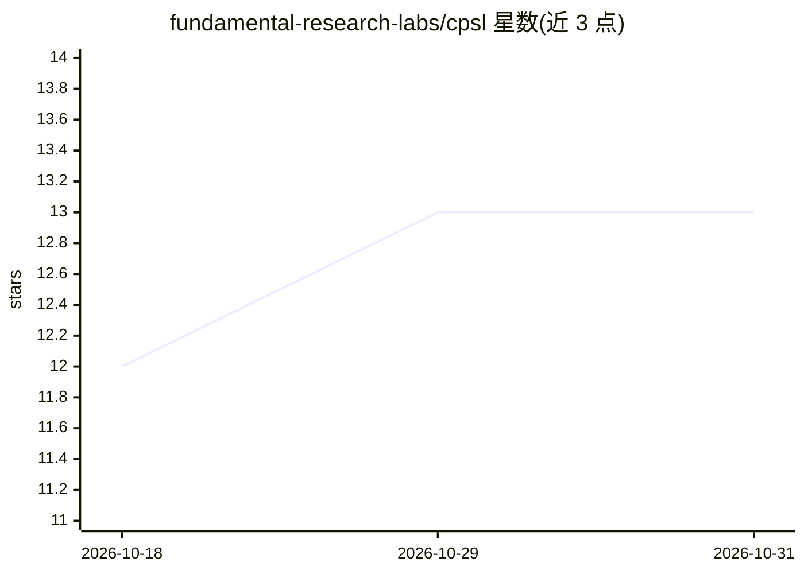

# fundamental-research-labs/cpsl

⭐ 13 · Rust · MIT · 推送 2026-08-12 · [GitHub](https://github.com/fundamental-research-labs/cpsl) · [官网](https://cpsl.io) · 组织维护

**面向 agent 的类 UNIX 沙箱运行时：打包工具/文件/权限为胶囊并执行**

Rust 实现的沙箱运行时：以 TOML manifest 定义胶囊（名称、模块白名单、允许的网络域），经 CLI 构建后在 Luau VM 中执行。支持三种语言接口——Bash 兼容命令、Python 风格脚本（转译到 Luau，非 CPython、不支持 pip 与原生包）、Luau 代码；另提供临时 scratch 沙箱模式。目标是跨 Linux/macOS/Windows/浏览器/iOS/Android 运行，SDK 与 CLI 发布产物仍在路线图中。项目自述为早期且快速演进，安装目前需 Rust/Cargo 从源码构建。

## 筛选速览

| 维度 | 判定 | 备注 |
|---|---|---|
| AI 角色 | `ai-ecosystem` | LLM/agent 周边工具 |
| 许可风险 | `permissive` | MIT |
| 部署形态 | `library` | 以包/库形式分发 |
| 模型依赖 | — | README 未给出锁定关系 |
| 硬件要求 | — | 无带数字的原话,不猜 |
| 安装摩擦 | `low` | 无编译、无系统依赖或容器化 |
| 成熟度 | `idea` | |

## 能力要点

- TOML manifest 按需启用模块（文件系统/网络/JSON/压缩等）与网络域白名单
- Bash/Python/Luau 三种语言接口，底层统一为 Luau VM 转译执行
- Luau VM 外加挂载表、模块注册表、HTTP 策略与宿主资源门控
- 跨平台目标：Linux/macOS/Windows/浏览器/iOS/Android，浏览器 demo 可在线运行

## 适用场景

- 为 AI agent 提供受控的类 UNIX 执行环境，限制其可访问的模块与网络
- 把工具、文件与权限打包成分发的胶囊
- 在沙箱内快速实验脚本（scratch 模式）

## 场景标签

`Agent 框架` · 领域:Agent 开发

## 证据(README 行号)

> L3: Safe, UNIX-like mini-OS capsules for agents, designed to run across Linux, macOS, Windows, web browsers, iOS, and An
> L5: Package tools, files, and permissions into a capsule. Build it. Run it.
> L11: The CPSL CLI builds capsules from TOML manifests:

## 星数曲线

2026-10-18 12 → 2026-10-31 13（+1）

---
*卡片 v1 · prompt 1.4 · 生成 2026-10-31 · 置信度 mid · 依据 README sha `0af2230f935b` · [字段定义](../../DATASET.md)*
