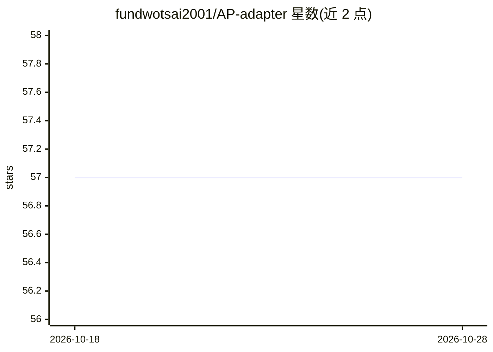

# fundwotsai2001/AP-adapter

⭐ 57 · Python · NOASSERTION · 推送 2025-11-10 · [GitHub](https://github.com/fundwotsai2001/AP-adapter) · 个人维护

**轻量微调的音频提示适配器：为文本生成音乐增加编辑能力**

ISMIR 2024 论文 Audio Prompt Adapter 的官方实现：在文本生成音乐模型（AudioLDM2）上加入适配器，通过音频提示实现音色迁移、风格迁移与伴奏生成三类音乐编辑任务。提供推理脚本与参数模板（ap_scale、time/frequency_pooling 控制音频强度），可下载预训练 checkpoint（35000 步、batchsize 32 训练），也可用 AudioSet 数据从零训练或微调，训练默认按 VRAM 24GB 以上配置并给出降显存选项。代码 Apache-2.0，checkpoint 部分权重 CC-BY-NC-SA-4.0。

## 筛选速览

| 维度 | 判定 | 备注 |
|---|---|---|
| AI 角色 | `ai-native` | 本体是模型或模型工具 |
| 许可风险 | `none` | NOASSERTION |
| 部署形态 | `library` | 以包/库形式分发 |
| 模型依赖 | — | README 未给出锁定关系 |
| 硬件要求 | `gpu-24g` | |
| 安装摩擦 | `low` | 无编译、无系统依赖或容器化 |
| 成熟度 | — | 结构信号不足 |

## 能力要点

- 支持 timbre_transfer / style_transfer / accompaniment_generation 三类任务
- 提供预训练 checkpoint 的 gdown 下载命令
- 可从零训练或基于已有 checkpoint 微调
- README 声明伴奏生成效果仍待改进

## 适用场景

- 用文本加音频提示做音乐音色或风格编辑
- 基于 AudioSet 数据训练/微调自己的适配器
- 复现 ISMIR 2024 论文的实验结果

## 场景标签

`微调` `模型训练` · 领域:训练与推理

## 证据(README 行号)

> L2: This is the official implementation of paper: "Audio Prompt Adapter: Unleashing Music Editing Abilities for Text-to-
> L37: python inferece --task timbre_transfer
> L38: python inferece --task style_transfer
> L39: python inferece --task accompaniment_generation

## 星数曲线

2026-10-18 57 → 2026-10-28 57（+0）

---
*卡片 v1 · prompt 1.4 · 生成 2026-10-24 · 置信度 mid · 依据 README sha `f0734ba1a0e1` · [字段定义](../../DATASET.md)*
