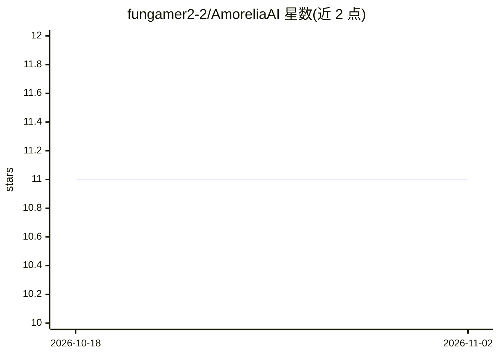

# fungamer2-2/AmoreliaAI

⭐ 11 · Python · MIT · 推送 2025-11-09 · [GitHub](https://github.com/fungamer2-2/AmoreliaAI) · 个人维护

**拟人化情感陪伴 AI：能思考、有情绪与长期记忆**

面向终端用户的虚拟陪伴应用，调用 Mistral AI API 生成对话。包含三套机制：思考系统在回答前生成内心独白并按复杂度自适应延长思考；情绪系统基于 PAD（愉悦-唤醒-支配）状态模型，随对话产生情绪并影响心情，无近期情绪时回归基线；记忆系统分短期（上下文内、容量有限）与长期（按相关性检索回收）两级，并周期性反思生成对用户的洞察。运行需 Python 与 Mistral API key，通过 pip 安装依赖后运行 main.py。

## 筛选速览

| 维度 | 判定 | 备注 |
|---|---|---|
| AI 角色 | `ai-native` | 本体是模型或模型工具 |
| 许可风险 | `permissive` | MIT |
| 部署形态 | `library` | 以包/库形式分发 |
| 模型依赖 | — | README 未给出锁定关系 |
| 硬件要求 | — | 无带数字的原话,不猜 |
| 安装摩擦 | `low` | 无编译、无系统依赖或容器化 |
| 成熟度 | — | 结构信号不足 |

## 能力要点

- 回答前生成内心独论的思考机制，按查询复杂度自适应延长
- 基于 PAD 模型的情绪系统，情绪影响心情并随时间回归基线
- 短期/长期两级记忆，可召回历史对话记忆并周期性反思生成洞察

## 适用场景

- 想要一个能记住过往对话并形成情感连接的虚拟陪伴
- 体验带情绪状态与内心独白的拟人化对话 AI

## 场景标签

`聊天机器人` · 领域:对话与助手

## 证据(README 行号)

> L7: Amorelia is a humanlike AI companion that can think, feel, and remember. It is designed to truly form connections wi
> L9: Currently uses Mistral AI models. You'll need a Mistral AI API key to use this project, and store it under `MISTRAL_

## 星数曲线

2026-10-18 11 → 2026-11-02 11（+0）

---
*卡片 v1 · prompt 1.4 · 生成 2026-11-02 · 置信度 mid · 依据 README sha `f1ba8248ef8b` · [字段定义](../../DATASET.md)*
