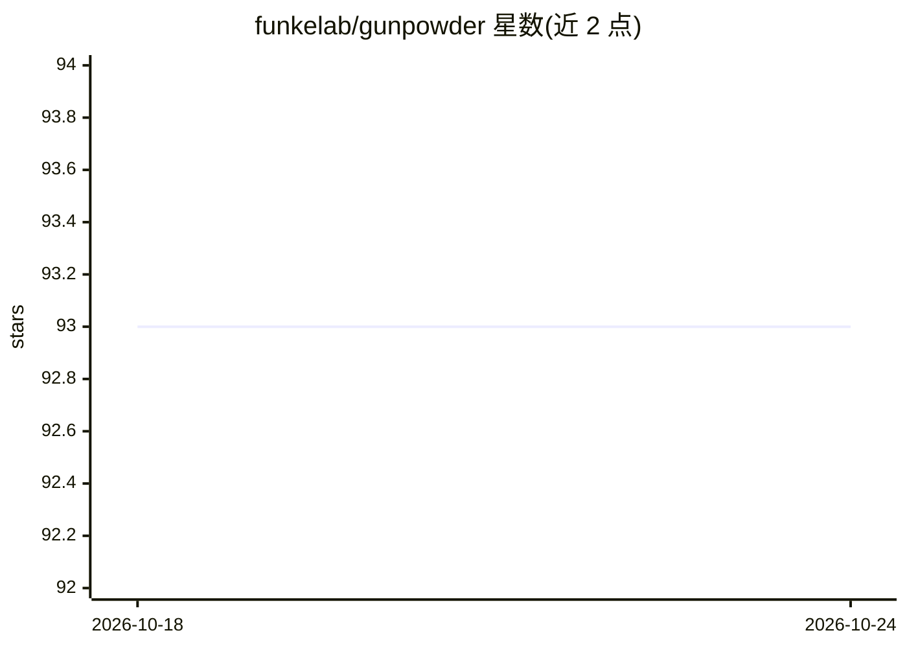

# funkelab/gunpowder

⭐ 93 · Python · MIT · 推送 2026-10-05 · [GitHub](https://github.com/funkelab/gunpowder) · [官网](https://funkelab.github.io/gunpowder/) · 组织维护

**面向大型多维图像的机器学习流水线构建库**

gunpowder 是一个 Python 库，用于在任意大的多维图像上组装机器学习流水线：覆盖数据加载、预处理、随机批量采样、数据增强、预缓存、训练/预测到结果存储等环节。它不绑定特定学习框架，可配合 torch、tensorflow 等库使用，定位为通用数据流水线与框架的补充。原始作者为 Jan Funke，设计受 PyGreentea 启发，由 funkelab 团队维护，提供完整文档链接。

## 筛选速览

| 维度 | 判定 | 备注 |
|---|---|---|
| AI 角色 | `ai-ecosystem` | LLM/agent 周边工具 |
| 许可风险 | `permissive` | MIT |
| 部署形态 | `None` |  |
| 模型依赖 | — | README 未给出锁定关系 |
| 硬件要求 | — | 无带数字的原话,不猜 |
| 安装摩擦 | `low` | 无编译、无系统依赖或容器化 |
| 成熟度 | — | 结构信号不足 |

## 能力要点

- 从数据加载到结果存储的全流程流水线组装
- 支持任意大的多维图像体数据
- 不绑定学习框架，配合 torch/tensorflow 使用

## 适用场景

- 为大型多维图像（如体积图像）训练模型构建数据流水线
- 组织预处理、增强、采样与预缓存等数据环节
- 在现有深度学习框架之外补充数据供给能力

## 场景标签

`图像视频处理` `MLOps` · 领域:感知与多模态

## 证据(README 行号)

> L7: `gunpowder` allows you to assemble a pipeline from
> L17: multi-dimensional images. `gunpowder` is not tied to a particular learning

## 星数曲线

2026-10-18 93 → 2026-10-24 93（+0）

---
*卡片 v1 · prompt 1.4 · 生成 2026-10-24 · 置信度 mid · 依据 README sha `005a70556791` · [字段定义](../../DATASET.md)*
