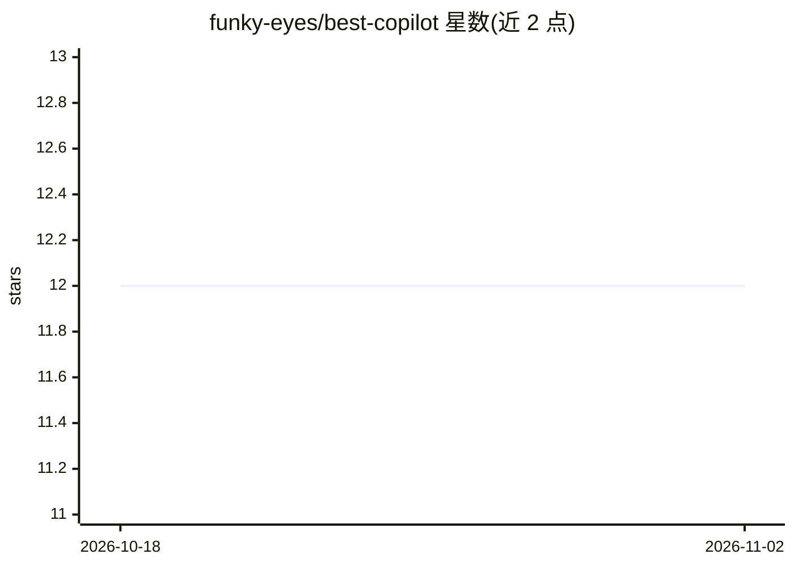

# funky-eyes/best-copilot

⭐ 12 · Shell · Apache-2.0 · 推送 2026-08-04 · [GitHub](https://github.com/funky-eyes/best-copilot) · 组织维护 · 中文 README

**面向 GitHub Copilot/Claude Code/Codex 的多 Agent 协作工作流插件**

以可安装插件形式为 Codex、Copilot CLI、Claude Code 三种编码 Agent 运行时提供统一的多 Agent 工作流：1 个 Senior Project Expert 协调入口、8 个专职子 Agent（规划/架构/实现/前端/QA/安全/根因修复/规格）、39 个可安装技能。通过仓库内记忆与规格文件实现长期上下文，采用共享契约层+角色工作流+运行时专有元数据的三层隔离架构；完成需证据（命令输出/静态检查/浏览器证据）。针对 Codex/Copilot/Claude 分别提供插件目录与适配器。

## 筛选速览

| 维度 | 判定 | 备注 |
|---|---|---|
| AI 角色 | `ai-ecosystem` | LLM/agent 周边工具 |
| 许可风险 | `permissive` | Apache-2.0 |
| 部署形态 | `None` |  |
| 模型依赖 | — | README 未给出锁定关系 |
| 硬件要求 | — | 无带数字的原话,不猜 |
| 安装摩擦 | `low` | 无编译、无系统依赖或容器化 |
| 成熟度 | — | 结构信号不足 |

## 能力要点

- 1 个 PM 协调 Agent + 8 个专职子 Agent 的分发-汇总流程
- 39 个可安装技能（TDD、设计评审、验证、分支收尾等）
- 记忆/规格/事实保存在目标仓库内而非插件包
- 三层隔离架构：共享契约 / 角色工作流 / 各运行时专有配置

## 适用场景

- 在 Claude Code 或 Copilot CLI 中以多 Agent 流程执行大型编码任务
- 为仓库建立'先冻结范围再实现再验证'的交付纪律
- 跨会话保留事实、记忆与规格以延续工作状态

## 场景标签

`多智能体` `编码 Agent` · 领域:Agent 开发

## 证据(README 行号)

> L15: `best-copilot` is an installable agent-team workflow for serious engineering work in Codex, Copilot CLI, and Claude
> L17: Codex uses `.codex-plugin/plugin.json`, `.agents/plugins/marketplace.json`, `.agents/skills -> ../skills`, and `.co
> L25: - **Thirty-nine skills**: role workflows, bootstrap, search, planning, workspace isolation, TDD, design review, exe

## 星数曲线

2026-10-18 12 → 2026-11-02 12（+0）

---
*卡片 v1 · prompt 1.4 · 生成 2026-11-01 · 置信度 high · 依据 README sha `677904e05d8b` · [字段定义](../../DATASET.md)*
