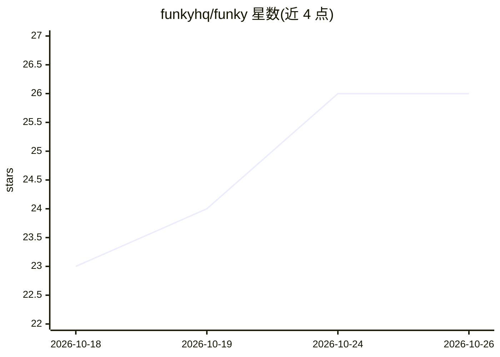

# funkyhq/funky

⭐ 26 · TypeScript · Apache-2.0 · 推送 2026-10-25 · [GitHub](https://github.com/funkyhq/funky) · [官网](https://funky.dev) · 组织维护

**面向 AI agent 的并行批量任务运行时引擎**

Funky 是运行并行、长生命周期 agent 工作负载的批处理引擎：定义 agent、为其分配 E2B 沙箱并发送任务；会话在无状态 worker 间并行执行，每步以 claim→step→commit 事务写入 Postgres 的 append-only 日志，worker 因 SIGKILL/OOM/部署中断后可由新 worker 从日志恢复，工具执行跨崩溃至多一次。支持 Anthropic/OpenAI/Google/Together AI/xAI 多推理供应商并路由，沙箱内可预装 apt/pip/npm 包，Infisical 存储密钥并以代理注入凭证。通过 Docker Compose 部署，提供 Web 控制台与 bearer 认证的 HTTP API（含 SSE 流）。

## 筛选速览

| 维度 | 判定 | 备注 |
|---|---|---|
| AI 角色 | `ai-ecosystem` | LLM/agent 周边工具 |
| 许可风险 | `permissive` | Apache-2.0 |
| 部署形态 | `self-host` | docker 或自建部署 |
| 模型依赖 | locked-api |  |
| 硬件要求 | — | 无带数字的原话,不猜 |
| 安装摩擦 | `low` | 无编译、无系统依赖或容器化 |
| 成熟度 | — | 结构信号不足 |

## 能力要点

- append-only 日志即 agent 状态，worker 无状态、崩溃后从日志恢复
- 会话级 E2B 沙箱，工具真正执行时才创建，包集构建为模板共享
- 多模型供应商适配（经 Vercel AI SDK 的供应商中立端口）
- docker compose --scale worker=N 线性扩缩 worker

## 适用场景

- 并行运行大量长时间 agent 任务并要求崩溃不丢进度
- 给 agent 配沙箱与受控凭证执行工具调用
- 在同一栈内混用多家模型供应商运行不同会话

## 场景标签

`Agent 框架` · 领域:Agent 开发

## 证据(README 行号)

> L7: Funky is your always-on task force for running parallel, long-lived agent workloads at scale.
> L9: Define your agents, give them sandboxed environments, and send them work. Funky runs
> L79: A config's `inference.provider` picks the vendor that serves it. At boot the worker wires

## 星数曲线

2026-10-18 23 → 2026-10-26 26（+3）

---
*卡片 v1 · prompt 1.4 · 生成 2026-10-26 · 置信度 mid · 依据 README sha `c2a6d8b7de61` · [字段定义](../../DATASET.md)*
