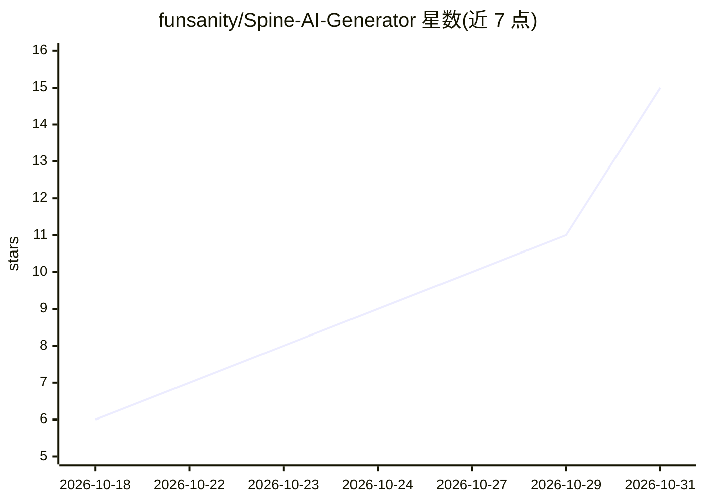

# funsanity/Spine-AI-Generator

⭐ 15 · JavaScript · Apache-2.0 · 推送 2026-10-19 · [GitHub](https://github.com/funsanity/Spine-AI-Generator) · 个人维护 · 中文 README

**把 2D 立绘自动拆件、建骨架并导出 Spine 资源的本地工具**

面向 2D 游戏骨骼动画制作的本地 Web 工具：上传单张立绘 PNG/JPG/WebP，用视觉模型生成部件表与遮挡层级，再经切图、遮挡补图、骨骼/网格生成，一键导出 Cocos Creator 3.8、Unity（spine-unity）、Spine 编辑器各版本可用资源及可二次编辑的 .spine 工程。核心流程仅需 Node 20+ 与一个视觉模型 API Key；MobileSAM/SAM 3 像素级分割与图像生成补图为可选增强，缺失时自动回退且不影响主流程。质量取决于源图，穿插碎、半透明多的图需人工收尾。

## 筛选速览

| 维度 | 判定 | 备注 |
|---|---|---|
| AI 角色 | `ai-native` | 本体是模型或模型工具 |
| 许可风险 | `permissive` | Apache-2.0 |
| 部署形态 | `library` | 以包/库形式分发 |
| 模型依赖 | locked-api |  |
| 硬件要求 | — | 无带数字的原话,不猜 |
| 安装摩擦 | `low` | 无编译、无系统依赖或容器化 |
| 成熟度 | — | 结构信号不足 |

## 能力要点

- 视觉模型输出结构化部件表，按遮挡关系自动推断父子层级
- 一键导出 Cocos 3.8 / Unity / Spine 4.0–4.2 多目标格式，各版本目录互不覆盖
- 可选 MobileSAM（约 800MB）或 SAM 3（约 4GB）做像素级分割，未安装时回退多边形蒙版
- 每个阶段带质量门：JSON 截断重试、补图失败重跑、Spine CLI 拒绝即报错

## 适用场景

- 把角色立绘快速拆件并生成可继续编辑的 Spine 工程起点
- 游戏项目批量产出 Cocos / Unity 可直接加载的骨骼动画资源
- 配合提示词模板为道具、特效、物品生成带正确 pivot 的骨架

## 场景标签

`目标检测` `图像生成` · 领域:内容生成

## 证据(README 行号)

> L22: |拆部件|抠图软件里一块块抠|AI 判断部件清单 + 像素级分割|
> L65: |AI 分析部件|**必需**：一个视觉模型 API Key|工具无法工作|
> L199: |视觉理解|**Claude 视觉模型**|要它输出结构化 JSON（部件表），不只是描述画面|

## 星数曲线

2026-10-18 6 → 2026-10-31 15（+9）

---
*卡片 v1 · prompt 1.4 · 生成 2026-10-31 · 置信度 high · 依据 README sha `5e8971849dc1` · [字段定义](../../DATASET.md)*
