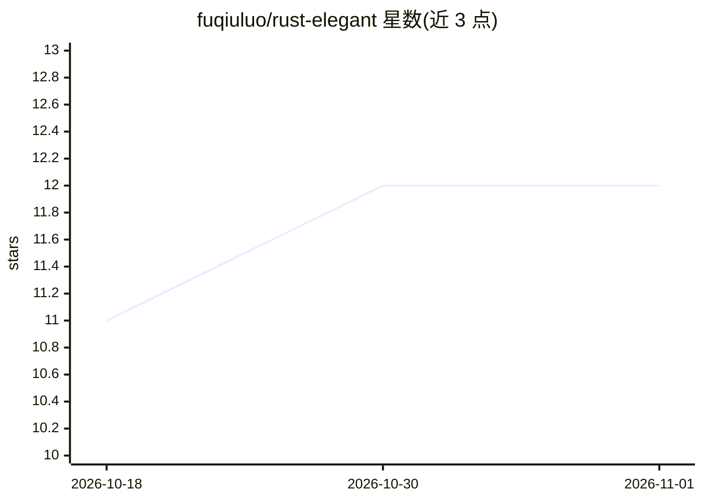

# fuqiuluo/rust-elegant

⭐ 12 · Python · Unlicense · 推送 2026-10-22 · [GitHub](https://github.com/fuqiuluo/rust-elegant) · 个人维护 · 中文 README

**教 Claude Code/Codex 写 Rust 的 Agent Skill 规则集**

面向 AI 编码 agent 的 Rust 编码规范技能包：以 SKILL.md 为入口，references/ 目录提供类型设计、命名、错误处理、所有权、迭代器、项目结构、注释等专题规范及 before/after 示例，每条规则标注默认做法与例外。要求 agent 改动后运行 cargo clippy 与 cargo test 验证，只约束本次改动代码。提供 Python 标准库编写的一键安装脚本，支持 Claude Code 与 Codex 的用户级/项目级安装、符号链接、卸载与 dry-run。

## 筛选速览

| 维度 | 判定 | 备注 |
|---|---|---|
| AI 角色 | `ai-knowledge` | 知识聚合/清单类 |
| 许可风险 | `permissive` | Unlicense |
| 部署形态 | `None` |  |
| 模型依赖 | — | README 未给出锁定关系 |
| 硬件要求 | — | 无带数字的原话,不猜 |
| 安装摩擦 | `low` | 无编译、无系统依赖或容器化 |
| 成熟度 | — | 结构信号不足 |

## 能力要点

- 覆盖类型设计/错误处理/所有权/迭代器/项目结构等 8 类 Rust 规范与例外说明
- 要求 agent 改动后运行 cargo clippy 与 cargo test 验证
- 一键安装脚本自动检测 Claude Code/Codex，支持用户级与项目级安装
- 支持 --link 符号链接安装以便 git pull 更新

## 适用场景

- 让 AI 编码 agent 按 Rust 社区惯例写代码
- 团队通过项目级安装共享统一的 Rust 代码规范
- 作为 review Rust 代码时的检查清单来源

## 场景标签

`提示工程` · 领域:Agent 开发

## 证据(README 行号)

> L3: 让 Claude Code 和 Codex 写出优雅的 Rust 代码的 Agent Skill。
> L108: ├── SKILL.md            # 入口：适用范围、诊断表、检查清单、cargo 验证流程

## 星数曲线

2026-10-18 11 → 2026-11-01 12（+1）

---
*卡片 v1 · prompt 1.4 · 生成 2026-11-01 · 置信度 high · 依据 README sha `b61f06f33770` · [字段定义](../../DATASET.md)*
