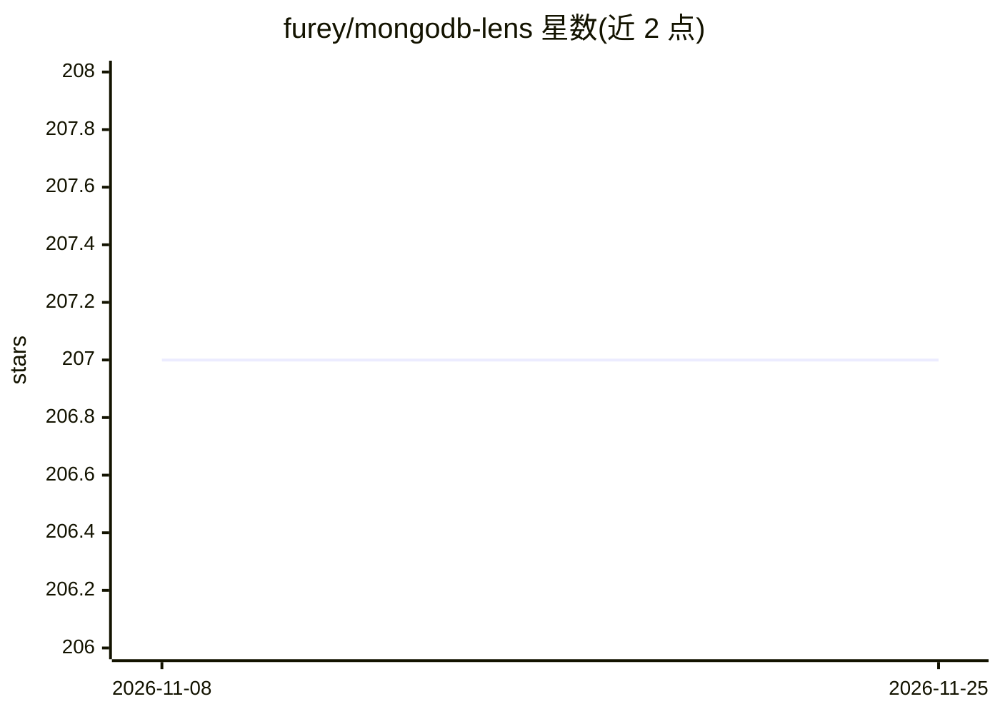

# furey/mongodb-lens

⭐ 207 · JavaScript · MIT · 推送 2026-11-21 · [GitHub](https://github.com/furey/mongodb-lens) · [官网](https://www.npmjs.com/package/mongodb-lens) · 个人维护

**面向 MongoDB 数据库的全功能 MCP 本地服务器**

本地运行的 Model Context Protocol (MCP) 服务器，向 LLM 客户端（如 Claude Desktop、Cursor）提供 MongoDB 数据库的完整访问能力：40 个工具覆盖查询、聚合、索引、用户管理、GridFS、事务、变更监听等；12 个资源暴露索引/模式/性能/副本集等元数据；13 个提示模板辅助聚合构建、查询优化、SQL 转换与安全审计。破坏性操作需两步确认，支持多连接别名、自动重连与配置文件，兼容新旧 MongoDB 版本。安装途径含 NPX、Docker Hub 与源码运行。

## 筛选速览

| 维度 | 判定 | 备注 |
|---|---|---|
| AI 角色 | `ai-ecosystem` | LLM/agent 周边工具 |
| 许可风险 | `permissive` | MIT |
| 部署形态 | `self-host` | docker 或自建部署 |
| 模型依赖 | — | README 未给出锁定关系 |
| 硬件要求 | — | 无带数字的原话,不猜 |
| 安装摩擦 | `low` | 无编译、无系统依赖或容器化 |
| 成熟度 | — | 结构信号不足 |

## 能力要点

- 40 个工具 + 12 个资源 + 13 个提示模板覆盖 MongoDB 管理与查询
- 破坏性操作的两步确认系统与查询安全限制
- 支持多命名连接别名与自动重连（指数退避）
- 兼容 MongoDB 4.0 以下旧版本（需替换 3.x 驱动从源码运行）

## 适用场景

- 在 Claude Desktop 或 Cursor 中用自然语言查询和优化 MongoDB 数据库
- 让 LLM 辅助设计聚合管道、索引与数据模型
- 通过 AI 客户端执行数据库健康检查与安全审计

## 场景标签

`数据分析` · 领域:效率与自动化

## 证据(README 行号)

> L8: **MongoDB Lens** is a local Model Context Protocol (MCP) server with full featured access to MongoDB databases using
> L16: - Set up your MCP Client (e.g. Claude Desktop, Cursor, etc)

## 星数曲线

2026-11-08 207 → 2026-11-25 207（+0）

---
*卡片 v1 · prompt 1.4 · 生成 2026-11-17 · 置信度 high · 依据 README sha `489c69027e61` · [字段定义](../../DATASET.md)*
