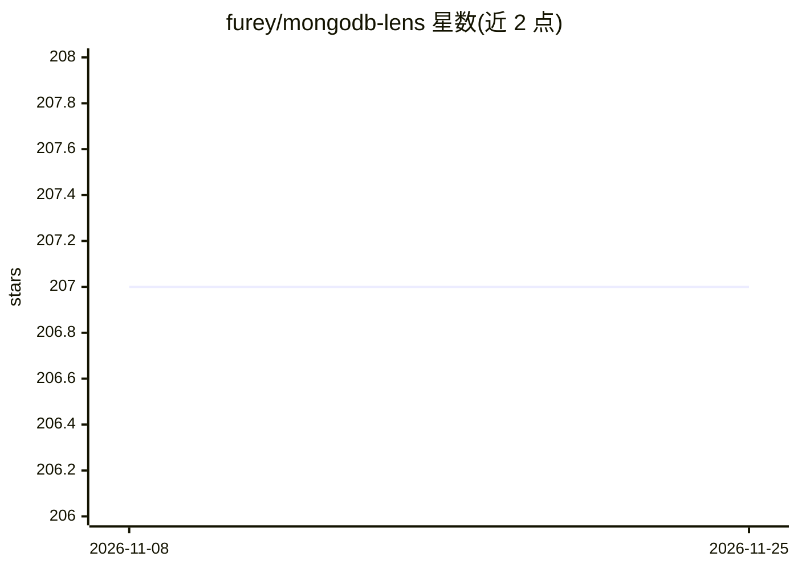

# furey/mongodb-lens

⭐ 207 · JavaScript · MIT · 推送 2026-11-21 · [GitHub](https://github.com/furey/mongodb-lens) · [官网](https://www.npmjs.com/package/mongodb-lens) · 个人维护

**让 LLM 通过自然语言操作 MongoDB 的 MCP 服务器**

一个本地运行的 Model Context Protocol 服务器，将 MongoDB 数据库暴露给 LLM 客户端：提供 40 余个工具（查询、聚合、建索引、GridFS、事务、地理/全文检索、破坏性操作两步确认）、12 类资源（schema、统计、副本集状态等）与 14 个提示模板（查询优化、备份策略、SQL 转 MongoDB 等）。支持多连接别名、schema 推断、查询防护与缓存管理。通过 NPX、Docker Hub、源码三种方式安装，兼容 MongoDB 4.0 及以上，旧版本需降级驱动。

## 筛选速览

| 维度 | 判定 | 备注 |
|---|---|---|
| AI 角色 | `ai-ecosystem` | LLM/agent 周边工具 |
| 许可风险 | `permissive` | MIT |
| 部署形态 | `self-host` | docker 或自建部署 |
| 模型依赖 | — | README 未给出锁定关系 |
| 硬件要求 | — | 无带数字的原话,不猜 |
| 安装摩擦 | `low` | 无编译、无系统依赖或容器化 |
| 成熟度 | — | 结构信号不足 |

## 能力要点

- 40+ 工具覆盖查询、聚合、索引、事务、GridFS 等操作
- 破坏性操作两步确认系统与可配置查询防护
- 14 个提示模板：查询优化、备份策略、SQL 转 MongoDB 等
- NPX / Docker Hub / 源码三种安装方式

## 适用场景

- 通过 Claude Desktop 等客户端用自然语言查询 MongoDB 数据
- 让 LLM 协助分析慢查询并给出索引建议
- 用 SQL 语句转换为 MongoDB 聚合管道
- 远程巡检数据库健康状态与 sharding 配置

## 场景标签

`数据分析` · 领域:效率与自动化

## 证据(README 行号)

> L8: **MongoDB Lens** is a local Model Context Protocol (MCP) server with full featured access to MongoDB databases using
> L16: - Set up your MCP Client (e.g. Claude Desktop, Cursor, etc)

## 星数曲线

2026-11-08 207 → 2026-11-25 207（+0）

---
*卡片 v1 · prompt 1.4 · 生成 2026-11-25 · 置信度 high · 依据 README sha `68357b913e2c` · [字段定义](../../DATASET.md)*
