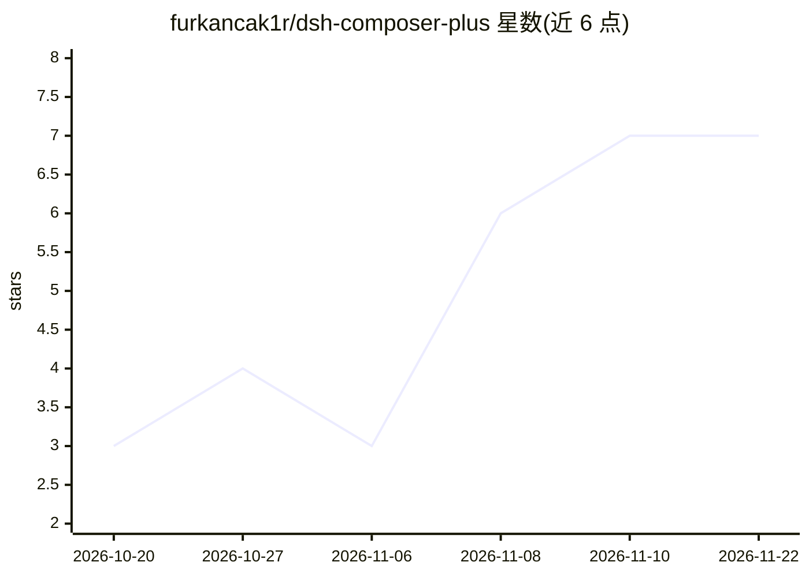

# furkancak1r/dsh-composer-plus

⭐ 7 · JavaScript · MIT · 推送 2026-11-20 · [GitHub](https://github.com/furkancak1r/dsh-composer-plus) · [官网](https://www.npmjs.com/package/dsh-composer-plus) · 个人维护 · 中文 README

**DeepSeek Harness (dsh) 的社区插件：为 coding agent 界面补足一批操作功能**

面向 DeepSeek Harness (dsh) 桌面与 Web UI 的非官方社区插件，通过 npm 包安装后在设置中启用。提供的功能包括：git Changes 面板（分支图、提交/文件 diff 浏览）、消息内文本搜索索引、回合回滚（可恢复文件）、聊天删除到回收站、↑/↓ 输入历史、Shift+Tab /plan 快捷键、一键 Continue、队列拖拽排序、会话 deeplink、Markdown 导出、后台通知、iPhone 访问（Tether 应用）、11 种界面语言与自动更新。部分功能（功能建议卡、下一条消息预测、目标检查等）会调用聊天所用的模型，可在设置中关闭。

## 筛选速览

| 维度 | 判定 | 备注 |
|---|---|---|
| AI 角色 | `ai-ecosystem` | LLM/agent 周边工具 |
| 许可风险 | `permissive` | MIT |
| 部署形态 | `None` |  |
| 模型依赖 | locked-api |  |
| 硬件要求 | — | 无带数字的原话,不猜 |
| 安装摩擦 | `low` | 无编译、无系统依赖或容器化 |
| 成熟度 | — | 结构信号不足 |

## 能力要点

- git Changes 面板：分支图、合并状态与逐文件 diff 浏览
- 回合回滚可同时恢复文件（含命令产生的改动）
- 功能建议卡片：模型读取项目摘要生成建议，支持 Later 列表与历史去重
- 11 种界面语言、自动更新与移动端连接

## 适用场景

- 在 dsh 中按分支和文件查看聊天对仓库的改动
- 通过回滚重新编辑已发送的消息并恢复文件状态
- 让模型基于项目内容提议新功能并一键开工

## 场景标签

 · 领域:开发者工具/编码 agent 插件

## 证据(README 行号)

> L1: # dsh-composer-plus — Composer Plus for DeepSeek Harness
> L9: Codex-style quality-of-life features for the DeepSeek Harness (dsh) desktop and web UI: a Changes panel, swipe-card 
> L19: **Desktop app:** Settings → Plugins → **Add plugin** → enter `dsh-composer-plus` → **Enable now**.

## 星数曲线

2026-10-20 3 → 2026-11-22 7（+4）

---
*卡片 v1 · prompt 1.4 · 生成 2026-11-20 · 置信度 high · 依据 README sha `86f7268008d8` · [字段定义](../../DATASET.md)*
