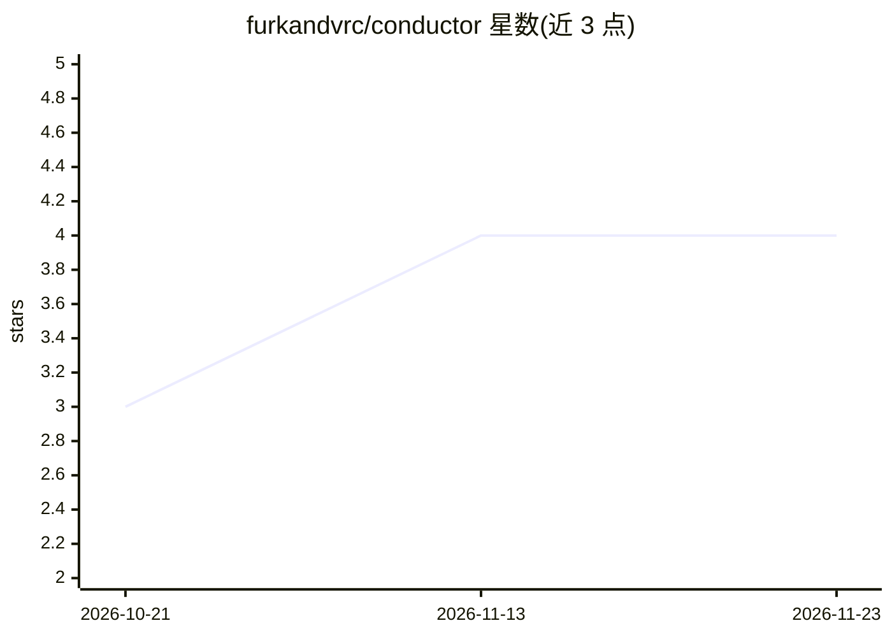

# furkandvrc/conductor

⭐ 4 · JavaScript · MIT · 推送 2026-11-15 · [GitHub](https://github.com/furkandvrc/conductor) · 个人维护 · 中文 README

**Claude Code/Codex 编排插件：Claude 主导，其他模型干批量活**

面向 Claude Code 与 Codex 的编排插件：主 agent 保留规划与审查角色，批量阅读、机械性编辑、第二意见评审通过 delegate 命令交给已配置的其他 CLI worker（claude、codex、gemini、cursor、copilot 等）或任意 OpenAI 兼容端点。worker 全部转录写入日志，仅 120 词内的短报告进入主 agent 上下文以节省 token。提供本地 dashboard 展示用量与成本、worker 开关与模型池配置，并支持多 Claude 账号达限自动轮换。仅支持 macOS/Linux。

## 筛选速览

| 维度 | 判定 | 备注 |
|---|---|---|
| AI 角色 | `ai-ecosystem` | LLM/agent 周边工具 |
| 许可风险 | `permissive` | MIT |
| 部署形态 | `library` | 以包/库形式分发 |
| 模型依赖 | local-ok | 支持本地模型 |
| 硬件要求 | — | 无带数字的原话,不猜 |
| 安装摩擦 | `low` | 无编译、无系统依赖或容器化 |
| 成熟度 | — | 结构信号不足 |

## 能力要点

- delegate 协议：brief worker→运行→验证→失败升级
- 8 种预置 worker CLI，另支持自定义 OpenAI 兼容端点与自定义 CLI
- 本地 dashboard 展示成本、缓存命中率与按模型日成本
- 多 Claude 账号达限自动轮换，任务自动续跑

## 适用场景

- 让低成本模型承担批量阅读与机械编辑以节省 Claude 用量
- 在 dashboard 里查看 Claude 成本与各 worker 表现
- 配置多个订阅账号在达限后自动切换继续工作

## 场景标签

`编码 Agent` `多智能体` · 领域:Agent 开发

## 证据(README 行号)

> L5: Conductor is a plugin for **Claude Code** and **Codex**. The agent you are talking to, Claude
> L20: |*your endpoints*|**any number** of OpenAI-compatible APIs: Ollama, LM Studio, vLLM, llama.cpp, OpenRouter…|free or

## 星数曲线

2026-10-21 3 → 2026-11-23 4（+1）

---
*卡片 v1 · prompt 1.4 · 生成 2026-11-21 · 置信度 mid · 依据 README sha `8445559735b5` · [字段定义](../../DATASET.md)*
