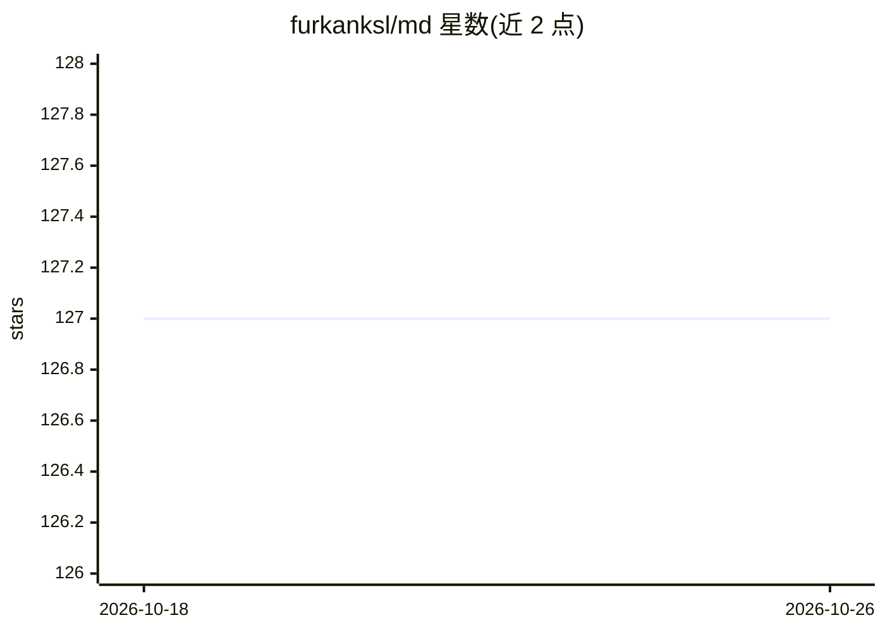

# furkanksl/md

⭐ 127 · TypeScript · 推送 2026-05-04 · [GitHub](https://github.com/furkanksl/md) · [官网](https://mydrawer.furkanksl.com) · 个人维护

**macOS 侧边抽屉式个人 AI 工作区：聊天/剪贴板/网页摘要**

基于 Tauri v2（Rust 后端）+ React（Vite）+ Bun 的 macOS 桌面应用，以常驻桌面的透明 Island 界面聚合多项功能：与多家 LLM 提供商对话（OpenAI/Anthropic/Google/Mistral/Groq/自定义），支持 Markdown 渲染、附件拖放与消息回滚；剪贴板历史管理与本地搜索；抓取网页内容交给 LLM 做摘要/问答；另有任务笔记、应用快捷方式、窗口布局管理。数据本地存储，需从源码构建运行（需 Node.js 18+/Bun 与 Rust 工具链），无预编译安装包说明。

## 筛选速览

| 维度 | 判定 | 备注 |
|---|---|---|
| AI 角色 | `ai-native` | 本体是模型或模型工具 |
| 许可风险 | `none` | — |
| 部署形态 | `library` | 以包/库形式分发 |
| 模型依赖 | — | README 未给出锁定关系 |
| 硬件要求 | — | 无带数字的原话,不猜 |
| 安装摩擦 | `low` | 无编译、无系统依赖或容器化 |
| 成熟度 | — | 结构信号不足 |

## 能力要点

- 多提供商 AI 聊天（OpenAI/Anthropic/Google/Mistral/Groq/自定义）
- 剪贴板历史自动追踪、搜索与本地管理
- 网页抓取内容送入 LLM 做摘要、分析与问答
- macOS 原生窗口布局与应用快捷方式管理

## 适用场景

- 在 macOS 桌面侧边快速与多家 LLM 对话
- 追踪和检索剪贴板历史记录
- 抓取网页让 AI 总结或问答，不离开当前工作流

## 场景标签

`AI 助手` `聊天机器人` · 领域:对话与助手

## 证据(README 行号)

> L3: **My Drawer** is a powerful, local-first personal AI workspace designed to integrate deeply with your macOS workflow
> L9: * **🧠 AI Chat**: Chat with various LLMs (OpenAI, Anthropic, Google, Mistral, Groq, or Custom). Features rich markdow

## 星数曲线

2026-10-18 127 → 2026-10-26 127（+0）

---
*卡片 v1 · prompt 1.4 · 生成 2026-10-23 · 置信度 high · 依据 README sha `f24eb57a3ed1` · [字段定义](../../DATASET.md)*
