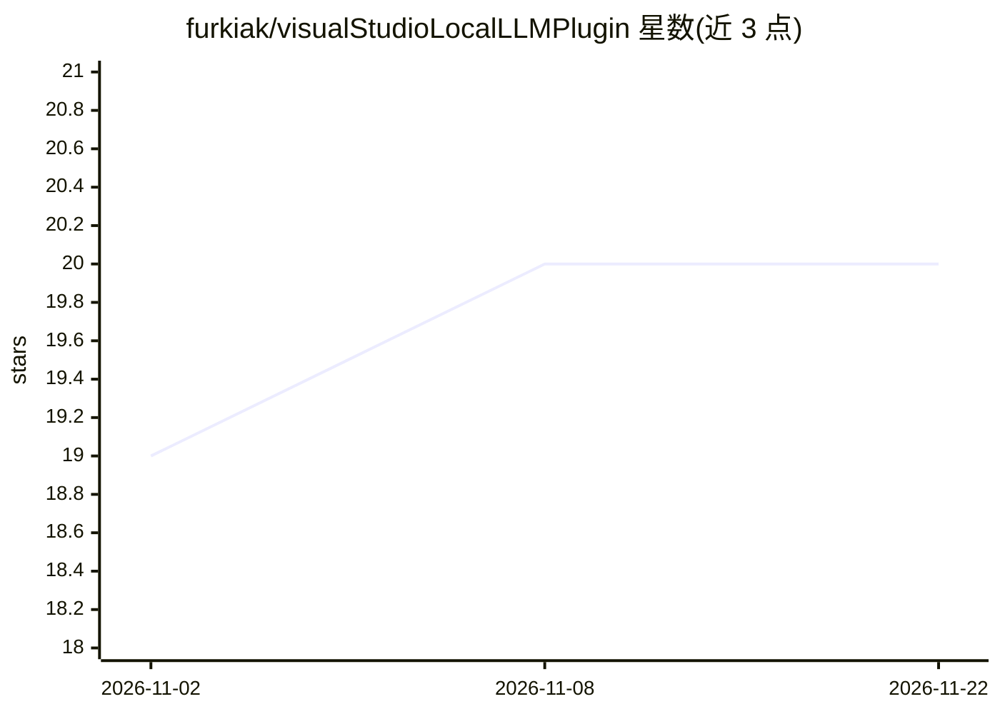

# furkiak/visualStudioLocalLLMPlugin

⭐ 20 · C# · AGPL-3.0 · 推送 2026-10-13 · [GitHub](https://github.com/furkiak/visualStudioLocalLLMPlugin) · [官网](https://marketplace.visualstudio.com/publishers/VisualStudioLocalLLMPlugin-WithOllama-ExtraTool) · 个人维护 · 中文 README

**Visual Studio 内的 AI 编程助手，支持本地与云端模型**

面向 Visual Studio 2022/2026 的 WPF 扩展（VSIX），在 IDE 内提供流式对话、快捷操作（解释/重构/修 bug/生成测试等）、代码应用（单步撤销、缩进匹配）与推理模型思维过程展示。提供商覆盖本地 Ollama、LM Studio 及任何 OpenAI 兼容服务器（llama.cpp、vLLM、Jan、LocalAI），云端支持 OpenAI、Anthropic、Gemini；API key 用 DPAPI 加密。另含无需 AI 的文本工具集。安装途径为 Visual Studio Marketplace 或 GitHub Releases 的 VSIX，也可用 msbuild 从源码构建。

## 筛选速览

| 维度 | 判定 | 备注 |
|---|---|---|
| AI 角色 | `ai-native` | 本体是模型或模型工具 |
| 许可风险 | `viral` | AGPL-3.0 |
| 部署形态 | `desktop` | 安装包/桌面程序 |
| 模型依赖 | local-ok | 支持本地模型 |
| 硬件要求 | — | 无带数字的原话,不猜 |
| 安装摩擦 | `high` | 编译与系统依赖俱全 |
| 成熟度 | — | 结构信号不足 |

## 能力要点

- 本地（Ollama/LM Studio/llama.cpp/vLLM 等）与云端（OpenAI/Anthropic/Gemini）提供商均支持流式输出
- 快捷操作：解释、重构、修 bug、优化、文档、单测、Review
- 代码应用单事务单步撤销，匹配缩进与行尾
- API key 经 Windows DPAPI 按提供商加密存储

## 适用场景

- 在 Visual Studio 里用本地模型写代码且不离开本机
- 把 AI 回答的代码一键应用到编辑器并可 Ctrl+Z 撤销
- 在多个本地/云端模型提供商之间切换对比

## 场景标签

`代码生成` · 领域:编码与开发

## 证据(README 行号)

> L6: Run models locally with **Ollama** or **LM Studio**, or use **OpenAI**, **Anthropic** and **Google Gemini** — with s
> L73: |**Streaming chat**|Answers stream live from every provider. Follow-up questions keep the conversation; *New chat* 

## 星数曲线

2026-11-02 19 → 2026-11-22 20（+1）

---
*卡片 v1 · prompt 1.4 · 生成 2026-11-18 · 置信度 high · 依据 README sha `8b5e76ebb5cc` · [字段定义](../../DATASET.md)*
