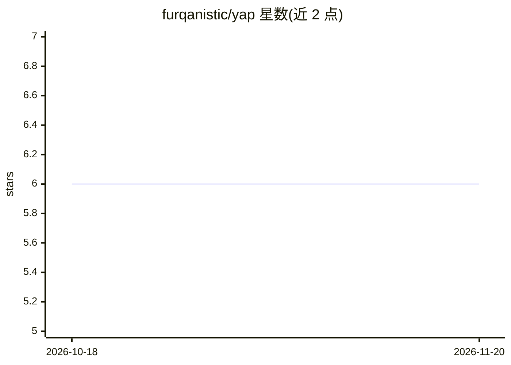

# furqanistic/yap

⭐ 6 · TypeScript · MIT · 推送 2026-11-16 · [GitHub](https://github.com/furqanistic/yap) · 个人维护

**桌面端 AI 语音听写应用，用 Tauri 与 React 构建**

Yap 是一款面向桌面用户的语音听写应用，将语音转为文字，基于 Tauri 2 与 React + TypeScript 构建。README 目前处于早期开发状态，声明内容会有快速变更；尚未列出模型供应商接入方式或成品安装包，仅给出从源码运行的流程，需要 Node.js 20+、Rust 稳定版及 Tauri 系统依赖。文档主要覆盖开发环境启动与生产构建命令，未提供使用界面、模型配置等功能的详细说明。

## 筛选速览

| 维度 | 判定 | 备注 |
|---|---|---|
| AI 角色 | `ai-native` | 本体是模型或模型工具 |
| 许可风险 | `permissive` | MIT |
| 部署形态 | `library` | 以包/库形式分发 |
| 模型依赖 | — | README 未给出锁定关系 |
| 硬件要求 | — | 无带数字的原话,不猜 |
| 安装摩擦 | `low` | 无编译、无系统依赖或容器化 |
| 成熟度 | `idea` | |

## 能力要点

- 基于 Tauri 2 + React + TypeScript 的桌面应用
- 提供语音听写（speech-to-text）功能
- 支持 npm run tauri dev 开发运行与 tauri build 生产构建

## 适用场景

- 在桌面端用语音输入代替键盘打字
- 开发者从源码构建并参与贡献

## 场景标签

`语音识别` · 领域:感知与多模态

## 证据(README 行号)

> L6: AI-powered voice dictation for the desktop, built with Tauri 2 and React + TypeScript.
> L8: > **Status:** early development. Expect rapid changes.
> L12: - Node.js 20+

## 星数曲线

2026-10-18 6 → 2026-11-20 6（+0）

---
*卡片 v1 · prompt 1.4 · 生成 2026-11-20 · 置信度 mid · 依据 README sha `0f9c8175d1d2` · [字段定义](../../DATASET.md)*
