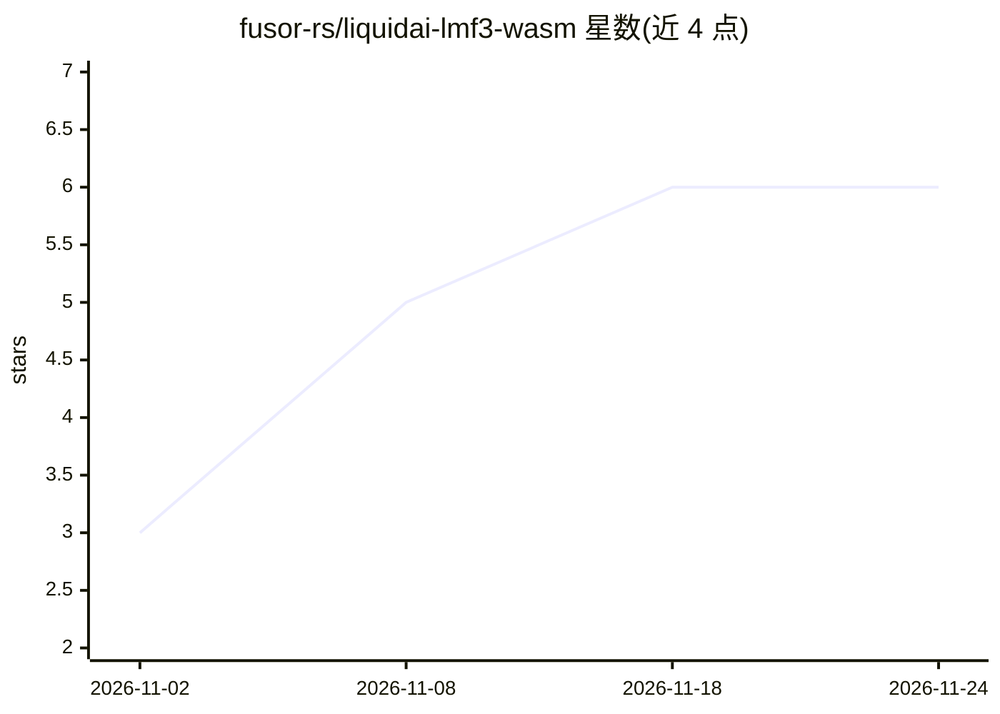

# fusor-rs/liquidai-lmf3-wasm

⭐ 6 · JavaScript · MIT · 推送 2026-11-12 · [GitHub](https://github.com/fusor-rs/liquidai-lmf3-wasm) · [官网](https://huggingface.co/spaces/fusorlabs/liquidai-lmf3-wasm) · 组织维护

**在浏览器 CPU 上运行 LiquidAI LFM3 全系模型的 Web 应用**

一个围绕 Liquid AI LFM3 系列模型构建的应用，含网页运行时与原生 CLI，模型经 fusor-ai 编译为 WebAssembly 后完全在浏览器 CPU 上运行，无服务器、无 API key。支持文本对话（带 thinking block）、图像问答（LFM3-VL-2B）、语音输入与输出（ASR/TTS，24 kHz 流式播放），以及 d1 决策模型对文本/图像/音频状态一次性回答具名、带类型的结构化问题。模型权重（3.5–4.5 GB）经 sha256/BLAKE3 校验后存于浏览器存储，README 声明推理期间网络请求计数为零，并注明当前为 v0.1 实验性软件。

## 筛选速览

| 维度 | 判定 | 备注 |
|---|---|---|
| AI 角色 | `ai-native` | 本体是模型或模型工具 |
| 许可风险 | `permissive` | MIT |
| 部署形态 | `None` |  |
| 模型依赖 | — | README 未给出锁定关系 |
| 硬件要求 | `cpu-ok` | |
| 安装摩擦 | `low` | 无编译、无系统依赖或容器化 |
| 成熟度 | `idea` | |

## 能力要点

- LFM3-1.7B/VL-2B/Audio-2B/Omni-2B 与 d1-2B/d1-Omni-2B 六个模型编译为 WASM 在 CPU 运行
- 7-bit 量化，模型 1963–2512 MB，页面按线程与 SIMD 能力选择四种构建之一
- d1 模型一次前向读取状态与最多 16 个具名类型化问题，支持 yes 概率、选项、数值、日期、检测框等答案类型
- 权重经 BLAKE3 分块校验存入浏览器源私有存储，运行时无网络/存储/时钟/熵能力导入

## 适用场景

- 在浏览器里与 LFM3 模型做文字对话并发送图片或语音
- 录制或上传语音并获取转录（ASR）或语音合成回复（TTS）
- 用 d1 模型对票据、发票等状态文本/图片做结构化问答与目标框标注
- 通过 CLI 以 JSON 文件驱动批量对话、决策并做基准与一致性比较

## 场景标签

`聊天机器人` `语音识别` `语音合成` `多模态` · 领域:对话与助手

## 证据(README 行号)

> L3: # Liquid AI's LFM3 in the browser, on the CPU
> L13: liquidai-lmf3-wasm is the app around the collection's models: a fusor page, the browser runtime and a native CLI. T

## 星数曲线

2026-11-02 3 → 2026-11-24 6（+3）

---
*卡片 v1 · prompt 1.4 · 生成 2026-11-20 · 置信度 high · 依据 README sha `134e7bfdb4ba` · [字段定义](../../DATASET.md)*
