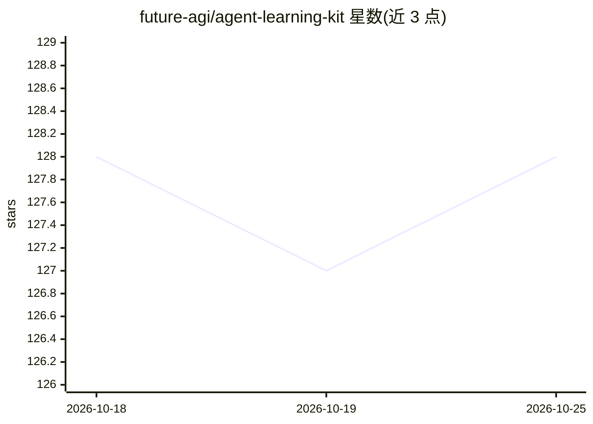

# future-agi/agent-learning-kit

⭐ 128 · Python · NOASSERTION · 推送 2026-10-25 · [GitHub](https://github.com/future-agi/agent-learning-kit) · [官网](https://futureagi.com) · 组织维护

**AI agent 本地优先的测试/仿真/红队/优化 SDK 与 CLI**

面向 AI agent 开发者的 Python SDK 与 CLI（agent-learn），整合三个引擎：simulate（本地世界/任务/框架适配器/回放）、evals（提示词、任务输出、trace、检索、安全等评测）、optimize（提示词/agent/工作流搜索优化），并以 harness 读取 agent 源码自动生成经验证测试场景。提供红队 campaign、本地 release-proof 门禁，默认全离线运行无需 API key，可选接入 Future AGI 平台。附带 TypeScript 评测包（npm 版本发布于 v1）。

## 筛选速览

| 维度 | 判定 | 备注 |
|---|---|---|
| AI 角色 | `ai-ecosystem` | LLM/agent 周边工具 |
| 许可风险 | `none` | NOASSERTION |
| 部署形态 | `library` | 以包/库形式分发 |
| 模型依赖 | — | README 未给出锁定关系 |
| 硬件要求 | — | 无带数字的原话,不猜 |
| 安装摩擦 | `low` | 无编译、无系统依赖或容器化 |
| 成熟度 | — | 结构信号不足 |

## 能力要点

- simulate/evals/optimize 三引擎合一的本地优先 CLI
- harness 读取 agent 源码自动构建世界与经验证测试场景
- 默认完全离线运行，无需 API key
- release-check/release-proof 本地发布证明门禁

## 适用场景

- 为 LangChain/LlamaIndex/AutoGen 等框架的 agent 做评测与回归回放
- 对 agent 工作流跑红队 campaign 与健壮性检查
- 在 CI 中以本地门禁证明 agent 发布就绪

## 场景标签

`模型评测` `提示工程` · 领域:Agent 开发

## 证据(README 行号)

> L21: Agent Learning Kit is the local-first SDK and CLI for testing, simulating,
> L30: - `evals`: evaluate prompts, task outputs, runtime contracts, traces, memory,
> L193: The public SDK is `agent-learning-kit`, the Python namespace is

## 星数曲线

2026-10-18 128 → 2026-10-25 128（+0）

---
*卡片 v1 · prompt 1.4 · 生成 2026-10-23 · 置信度 mid · 依据 README sha `53656c31e70c` · [字段定义](../../DATASET.md)*
