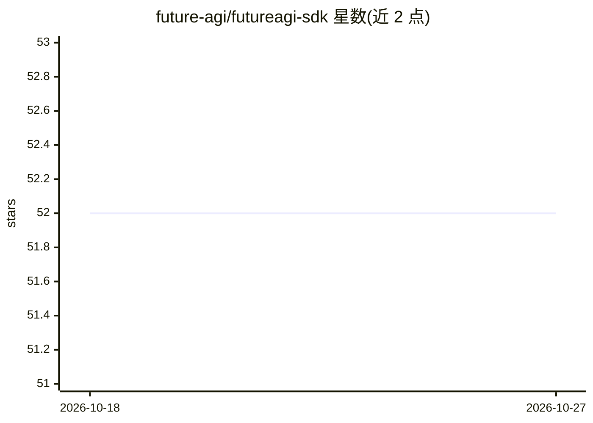

# future-agi/futureagi-sdk

⭐ 52 · Python · Apache-2.0 · 推送 2026-10-26 · [GitHub](https://github.com/future-agi/futureagi-sdk) · [官网](https://app.futureagi.com) · 组织维护

**面向开发者的 AI 评测、护栏与提示词管理 SDK**

提供 Python 与 TypeScript 双语言 SDK，覆盖数据集版本管理、提示词版本控制与 A/B 测试、知识库（RAG 文档管理）、自动化评测（50+ 指标、LLM-as-judge）、实时护栏（亚 100ms）与基于 OpenTelemetry 的追踪分析。使用需从 Dashboard 获取 API key，通过 pip/npm 安装；支持云与自托管部署，自托管需联系厂商。集成 OpenAI/Anthropic/Bedrock/Ollama 等提供商及 LangChain 等框架。

## 筛选速览

| 维度 | 判定 | 备注 |
|---|---|---|
| AI 角色 | `ai-ecosystem` | LLM/agent 周边工具 |
| 许可风险 | `permissive` | Apache-2.0 |
| 部署形态 | `library` | 以包/库形式分发 |
| 模型依赖 | — | README 未给出锁定关系 |
| 硬件要求 | — | 无带数字的原话,不猜 |
| 安装摩擦 | `low` | 无编译、无系统依赖或容器化 |
| 成熟度 | — | 结构信号不足 |

## 能力要点

- 50+ 评测指标、LLM-as-judge 与自定义 rubric
- 亚 100ms 延迟的实时护栏
- 提示词版本控制、A/B 测试与部署标签
- OpenTelemetry 原生追踪，覆盖 50+ 框架

## 适用场景

- 对 AI agent 输出做自动化质量评测与幻觉拦截
- 管理提示词版本并做 A/B 测试与回滚
- 管理 RAG 知识库文档并评测检索效果
- 上线前用模拟场景测试 AI 系统

## 场景标签

`模型评测` `提示工程` `LLM 可观测性` · 领域:Agent 开发

## 证据(README 行号)

> L5: **The open-source SDK for AI evaluation, observability, and optimization**
> L34: - **🎯 Evaluations** — 50+ metrics, LLM-as-judge, and custom rubrics powered by the Critique AI agent
> L35: - **⚡ Guardrails** — Real-time safety checks with sub-100ms latency

## 星数曲线

2026-10-18 52 → 2026-10-27 52（+0）

---
*卡片 v1 · prompt 1.4 · 生成 2026-10-24 · 置信度 high · 依据 README sha `81759caa6d84` · [字段定义](../../DATASET.md)*
