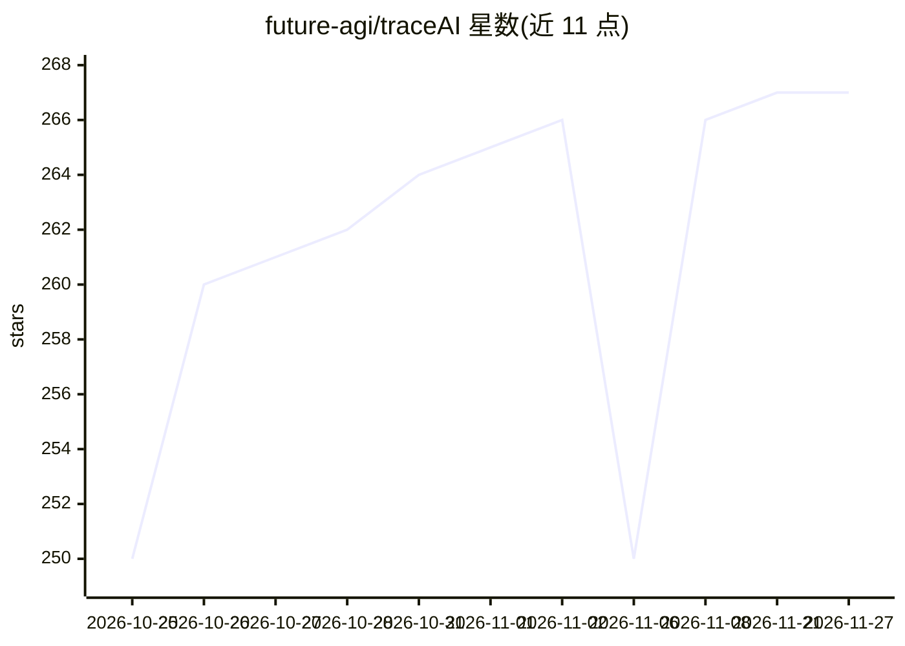

# future-agi/traceAI

⭐ 267 · Python · Apache-2.0 · 推送 2026-11-26 · [GitHub](https://github.com/future-agi/traceAI) · [官网](https://app.futureagi.com) · 组织维护

**为 AI 应用与框架提供基于 OpenTelemetry 的调用链追踪框架**

traceAI 提供 AI 应用的可观测追踪：在 SDK 边界插桩，将 LLM 调用、agent、工具执行与检索以 OpenTelemetry span 与 context 串联，支持内容脱敏与经自有 OTel 管道导出。覆盖 80 个集成族、5 种语言（Python/TypeScript/Java/Go/C#），提供 Node.js 零代码追踪、各语言自动插桩与显式 instrumentor。追踪默认发送到 Future AGI 平台，也可配置自有的 tracer provider 与 exporter。Apache 2.0 许可。

## 筛选速览

| 维度 | 判定 | 备注 |
|---|---|---|
| AI 角色 | `ai-ecosystem` | LLM/agent 周边工具 |
| 许可风险 | `permissive` | Apache-2.0 |
| 部署形态 | `library` | 以包/库形式分发 |
| 模型依赖 | local-ok | 支持本地模型 |
| 硬件要求 | — | 无带数字的原话,不猜 |
| 安装摩擦 | `medium` | 含编译或系统依赖之一 |
| 成熟度 | — | 结构信号不足 |

## 能力要点

- 零代码追踪：Node.js 通过 @traceai/auto 预加载即可捕获 AI 调用
- 5 种语言的 SDK/自动插桩与手动 span API
- 80 个集成族清单，覆盖模型提供方、agent 框架、RAG/向量库、网关等
- 内容脱敏配置（FI_HIDE_INPUTS/OUTPUTS/ERROR_DETAILS）

## 适用场景

- 为 LLM 应用接入 OpenTelemetry 追踪并保留现有可观测栈
- 排查 agent/工具/检索链路中的模型调用
- 在导出前对提示词与响应内容做脱敏

## 场景标签

`LLM 可观测性` · 领域:评测与运维

## 证据(README 行号)

> L3: **OpenTelemetry tracing for AI applications.**
> L5: Trace LLM calls, agents, tools, and retrieval. Keep your application code and your observability stack.

## 星数曲线

2026-10-25 250 → 2026-11-27 267（+17）

---
*卡片 v1 · prompt 1.4 · 生成 2026-11-25 · 置信度 high · 依据 README sha `05b71342c4e7` · [字段定义](../../DATASET.md)*
