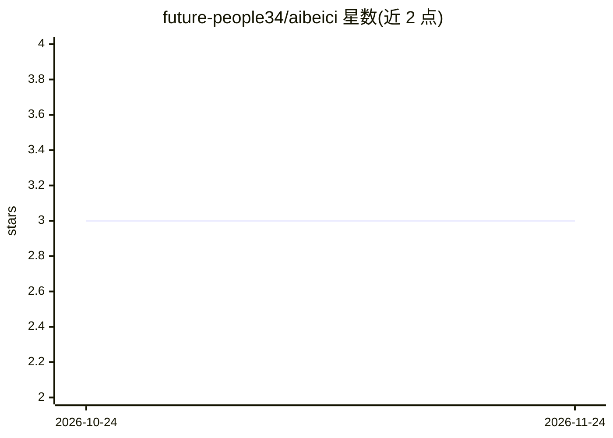

# future-people34/aibeici

⭐ 3 · TypeScript · MIT · 推送 2026-10-30 · [GitHub](https://github.com/future-people34/aibeici) · 个人维护 · 中文 README

**本地优先的六级背单词应用：AI 判语义、FSRS 排复习**

本地优先的六级背单词应用：用户看英文单词写出中文意思，由大模型按语义判分（对/部分正确/错），并用 FSRS 算法按遗忘曲线安排复习间隔。学完当天词汇后自动生成一篇包含所学词汇的阅读理解（5 道选择题）及生词表和中文翻译。判分采用三层机制：本地规则命中、本地拦截、大模型兜底，结果按词+答案缓存。词库 5336 个六级词本地存储于 IndexedDB，可通过 PWA 或 Android APK 使用，需自填 DeepSeek API Key。

## 筛选速览

| 维度 | 判定 | 备注 |
|---|---|---|
| AI 角色 | `ai-native` | 本体是模型或模型工具 |
| 许可风险 | `permissive` | MIT |
| 部署形态 | `library` | 以包/库形式分发 |
| 模型依赖 | locked-api |  |
| 硬件要求 | — | 无带数字的原话,不猜 |
| 安装摩擦 | `low` | 无编译、无系统依赖或容器化 |
| 成熟度 | — | 结构信号不足 |

## 能力要点

- 三层判分：本地规则覆盖 97.3% 正确作答，模糊表述转大模型并缓存结果
- FSRS 复习调度：按目标保持率反算间隔，含易忘词压间隔与当天重考机制
- 每天自动生成包含所学词汇的阅读理解，附生词表与全文中文翻译
- 词库与学习记录全本地（IndexedDB），可导出/导入备份，支持 PWA 与 Android APK

## 适用场景

- 备考大学英语六级的产出型词汇记忆
- 离线环境下管理个人单词复习计划
- 用 AI 判分代替选择题式的再认型背单词

## 场景标签

 · 领域:教育/语言学习

## 证据(README 行号)

> L6: **看英文，写中文 —— 让模型判断你想起来的意思对不对，再按遗忘曲线安排复习，最后用当天学的词写一篇阅读理解。**
> L20: 所以判分交给大模型按语义判断，而不是字符串比对。判完之后，再按你这次的表现更新这个词的复习间隔。
> L98: |L3 大模型|L1 没命中的模糊表述|≈¥0.002/次|~1s|

## 星数曲线

2026-10-24 3 → 2026-11-24 3（+0）

---
*卡片 v1 · prompt 1.4 · 生成 2026-11-22 · 置信度 high · 依据 README sha `f4f6e3484083` · [字段定义](../../DATASET.md)*
