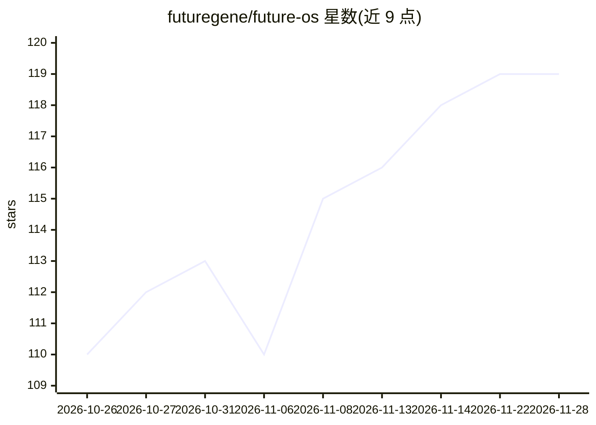

# futuregene/future-os

⭐ 119 · Rust · MIT · 推送 2026-11-27 · [GitHub](https://github.com/futuregene/future-os) · [官网](https://future-os.cn) · 组织维护 · 中文 README

**跨终端/桌面/手机/IM 的统一个人 AI agent（Rust）**

以单个 Rust 核心（二进制 + gRPC agent）驱动终端 TUI、桌面应用、移动端、CLI 与 IM 机器人的个人 AI agent 平台，各端共享会话、记忆与技能。提供四档工具执行边界（off/manual/sandbox/auto）、macOS Seatbelt/Linux Bubblewrap 沙箱、面向 24+ 小时长任务的 goal 控制平面（事件溯源状态、验证门）、定时任务、15+ 内置技能与可 fork 的会话历史。安装为平台脚本（macOS/Linux/Windows），移动端 pairing 需账号，中继可自托管。

## 筛选速览

| 维度 | 判定 | 备注 |
|---|---|---|
| AI 角色 | `ai-native` | 本体是模型或模型工具 |
| 许可风险 | `permissive` | MIT |
| 部署形态 | `None` |  |
| 模型依赖 | — | README 未给出锁定关系 |
| 硬件要求 | — | 无带数字的原话,不猜 |
| 安装摩擦 | `low` | 无编译、无系统依赖或容器化 |
| 成熟度 | — | 结构信号不足 |

## 能力要点

- 单一 gRPC agent 驱动 TUI/桌面/移动/CLI/IM 机器人，共享会话与技能
- 四档工具执行边界（off/manual/sandbox/auto）与 OS 级沙箱
- 面向 24+ 小时长任务的 goal 控制平面与验证门
- 端到端加密的 phone↔host 通道，中继可自托管

## 适用场景

- 在手机上查看和控制家中/实验室桌面上的 agent 会话
- 夜间启动长时研究任务，次日手机上审阅结果
- 按计划定时运行带完整权限的重复任务
- 通过 TUI 以树状结构查看工具调用与思考过程

## 场景标签

`AI 助手` `Agent 框架` · 领域:Agent 开发

## 证据(README 行号)

> L3:  One AI agent, everywhere you work.
> L24: - **One backend, every surface.** A single gRPC agent drives the terminal UI, desktop app, mobile apps, CLI, and IM
> L35: |**Model Flexibility**|**Bring your own key**: the built-in catalog covers the major providers, and any OpenAI- or 

## 星数曲线

2026-10-26 110 → 2026-11-28 119（+9）

---
*卡片 v1 · prompt 1.4 · 生成 2026-11-28 · 置信度 high · 依据 README sha `636635d4c23d` · [字段定义](../../DATASET.md)*
