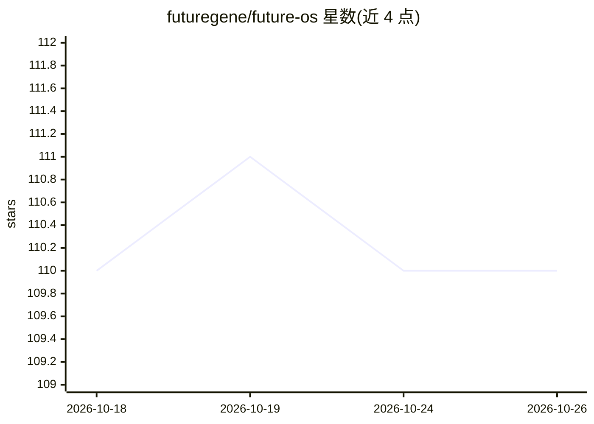

# futuregene/future-os

⭐ 110 · Rust · MIT · 推送 2026-10-25 · [GitHub](https://github.com/futuregene/future-os) · [官网](https://future-os.cn) · 组织维护 · 中文 README

**跨终端/桌面/移动/IM 的个人 AI 代理，Rust 单核多端**

以单一 Rust gRPC Agent 后端驱动 TUI、桌面 GUI、Android/iOS 移动端、CLI 与 IM 机器人的多端 AI 代理应用，会话、记忆与技能各端共享。支持 BYOK 接入内置目录中的主流模型商及任意 OpenAI/Anthropic 兼容端点，或登录 FutureOS 托管服务由其配发密钥。提供文件访问审批与 OS 沙箱分级（off/manual/sandbox）、24 小时以上长程任务的 goal 控制面、定时任务、会话 fork/clone、技能包安装等。安装脚本校验 SHA-256 后安装签名应用；默认桌面审批级别为 Unrestricted（off）。

## 筛选速览

| 维度 | 判定 | 备注 |
|---|---|---|
| AI 角色 | `ai-native` | 本体是模型或模型工具 |
| 许可风险 | `permissive` | MIT |
| 部署形态 | `None` |  |
| 模型依赖 | — | README 未给出锁定关系 |
| 硬件要求 | — | 无带数字的原话,不猜 |
| 安装摩擦 | `low` | 无编译、无系统依赖或容器化 |
| 成熟度 | — | 结构信号不足 |

## 能力要点

- 单 gRPC Agent 后端驱动 TUI/桌面/移动/CLI/IM 五类客户端，会话与记忆共享
- 工具审批规则与三档 OS 沙箱（macOS Seatbelt / Linux Bubblewrap / Windows 受限令牌）
- 长程任务的 goal 控制面：持久目标、事件溯源状态、验证门，支持 24 小时以上运行
- BYOK 支持内置模型目录与任意 OpenAI/Anthropic 兼容端点（models.json）

## 适用场景

- 在终端、桌面与手机上继续同一个 AI 代理会话
- 配置审批与沙箱后让代理执行文件读写与 shell 工具
- 设置夜间定时运行的长程研究任务并在手机上查看结果
- 通过技能包扩展代理的图像、PDF 解析、浏览器控制等能力

## 场景标签

`AI 助手` · 领域:对话与助手

## 证据(README 行号)

> L3:  One AI agent, everywhere you work.
> L25: - **One backend, every surface.** A single gRPC agent drives the terminal UI, desktop app, mobile apps, CLI, and IM
> L34: |**Model Flexibility**|**Bring your own key**: the built-in catalog covers the major providers, and any OpenAI- or 

## 星数曲线

2026-10-18 110 → 2026-10-26 110（+0）

---
*卡片 v1 · prompt 1.4 · 生成 2026-10-23 · 置信度 high · 依据 README sha `655d3fcadd0a` · [字段定义](../../DATASET.md)*
