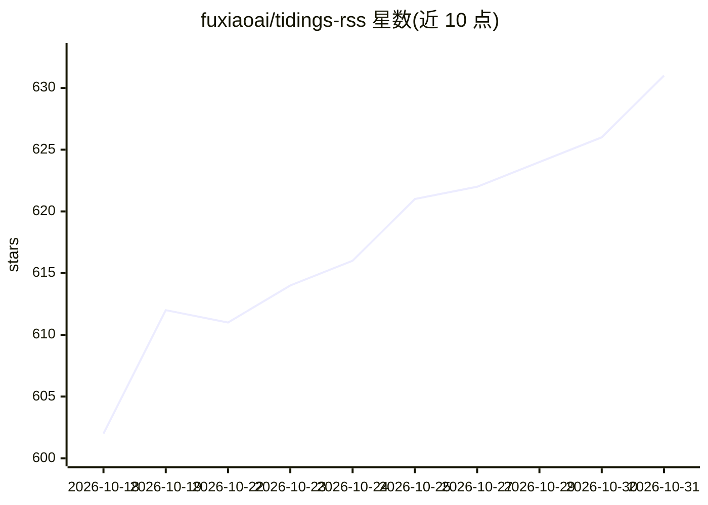

# fuxiaoai/tidings-rss

⭐ 631 · Python · CC0-1.0 · 推送 2026-10-01 · [GitHub](https://github.com/fuxiaoai/tidings-rss) · [官网](https://tidings.info/) · 组织维护 · 中文 README

**经活体验证的 RSS 订阅源 OPML 策展合集（718 源，14 类）**

以 OPML 文件形式提供的订阅源目录：718 个源按 AI、工程、安全、科技媒体、科研、视频、播客、微信公众号等 14 类组织，提供 Top 200 精选包与主题包供 RSS 阅读器直接导入。候选源经生产解析器三轮检查（须返回文章与真实发布日期），目录定期复查，附 SHA-256 校验和与机器可读目录。README 同时介绍配套阅读器 Tidings（macOS 12+）的聚合、播客、AI 摘要/问答/雷达/翻译等功能，AI 需用户自选提供方，Pro 为软件许可不含模型用量。本仓库内容以 CC0-1.0 发布。

## 筛选速览

| 维度 | 判定 | 备注 |
|---|---|---|
| AI 角色 | `ai-knowledge` | 知识聚合/清单类 |
| 许可风险 | `viral` | CC0-1.0 |
| 部署形态 | `None` |  |
| 模型依赖 | — | README 未给出锁定关系 |
| 硬件要求 | — | 无带数字的原话,不猜 |
| 安装摩擦 | `low` | 无编译、无系统依赖或容器化 |
| 成熟度 | — | 结构信号不足 |

## 能力要点

- 718 源目录组织为 Top 200 与多主题 OPML 包
- 候选源经生产解析器三轮验证（文章与真实日期）
- 提供 SHA-256 校验和与机器可读目录（data/feeds.json）
- 中英源均衡覆盖，含 349 个中文独立博客与 30 个微信公众号

## 适用场景

- 向任意 RSS 阅读器一键导入高质量订阅源
- 按主题（AI/安全/科研/播客）挑选订阅包
- 快速建立覆盖中英文的信源阅读清单

## 场景标签

`精选清单` · 领域:学习与行业

## 证据(README 行号)

> L4:  High-quality feeds, organized into OPML bundles you can import directly.
> L5:  Start with the Top 200, then use topic bundles or the 718-source directory when you want more. Catalog last checked
> L22: |⭐ Top 200 (recommended)|`200`|Download `tidings-top200.opml`|Broad, high-quality coverage with a much smaller clea

## 星数曲线

2026-10-18 602 → 2026-10-31 631（+29）

---
*卡片 v1 · prompt 1.4 · 生成 2026-10-21 · 置信度 mid · 依据 README sha `d415ab80ba7a` · [字段定义](../../DATASET.md)*
