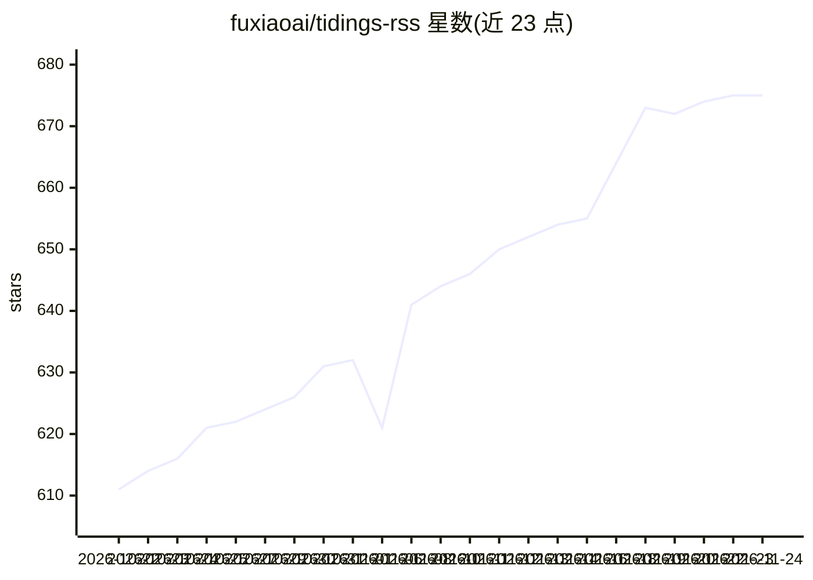

# fuxiaoai/tidings-rss

⭐ 676 · Python · CC0-1.0 · 推送 2026-11-03 · [GitHub](https://github.com/fuxiaoai/tidings-rss) · [官网](https://tidings.info/) · 组织维护 · 中文 README

**经持续验证的 AI/科研/新闻等 RSS 订阅 OPML 合集（718 源）**

仓库提供可导入任意阅读器的 OPML 订阅源合集：Top 200 精选、718 源完整目录及 14 个主题分包（中文独立博客、AI、安全、微信公众号、播客等），配套 SHA-256 校验与机器可读目录。收录标准基于作者声誉与一手来源，每个源经生产解析器三轮验证可达性并定期复查。同站推荐配套的 Tidings macOS 阅读器（12+），支持 RSS/Atom/JSON Feed 聚合、播客播放、AI 摘要与逐段翻译等。

## 筛选速览

| 维度 | 判定 | 备注 |
|---|---|---|
| AI 角色 | `ai-knowledge` | 知识聚合/清单类 |
| 许可风险 | `viral` | CC0-1.0 |
| 部署形态 | `None` |  |
| 模型依赖 | — | README 未给出锁定关系 |
| 硬件要求 | — | 无带数字的原话,不猜 |
| 安装摩擦 | `low` | 无编译、无系统依赖或容器化 |
| 成熟度 | `idea` | |

## 能力要点

- 718 源完整目录按 14 类组织，提供 Top 200 与多主题 OPML 分包
- 每个订阅源经生产解析器三轮验证并定期复查（目录最近核查 2026-11-03）
- 中英来源均衡，含 469 个中文源分包与微信公众号源
- 配套 macOS 阅读器 Tidings，支持 AI Radar、摘要、逐段翻译与 FreshRSS 同步

## 适用场景

- 一键导入高质量 RSS 订阅合集到任意阅读器
- 系统跟踪 AI、安全、科研领域的博客与官方发布
- 在应用外阅读精选微信公众号文章
- 搭建个人播客与视频订阅库

## 场景标签

`精选清单` · 领域:学习与行业

## 证据(README 行号)

> L4:  High-quality feeds, organized into OPML bundles you can import directly.
> L107: All 718 feeds in the complete collection are listed below with their primary category and bundles. This appendix i

## 星数曲线

2026-10-22 611 → 2026-11-24 675（+64）

---
*卡片 v1 · prompt 1.4 · 生成 2026-11-24 · 置信度 mid · 依据 README sha `1a993eafa865` · [字段定义](../../DATASET.md)*
