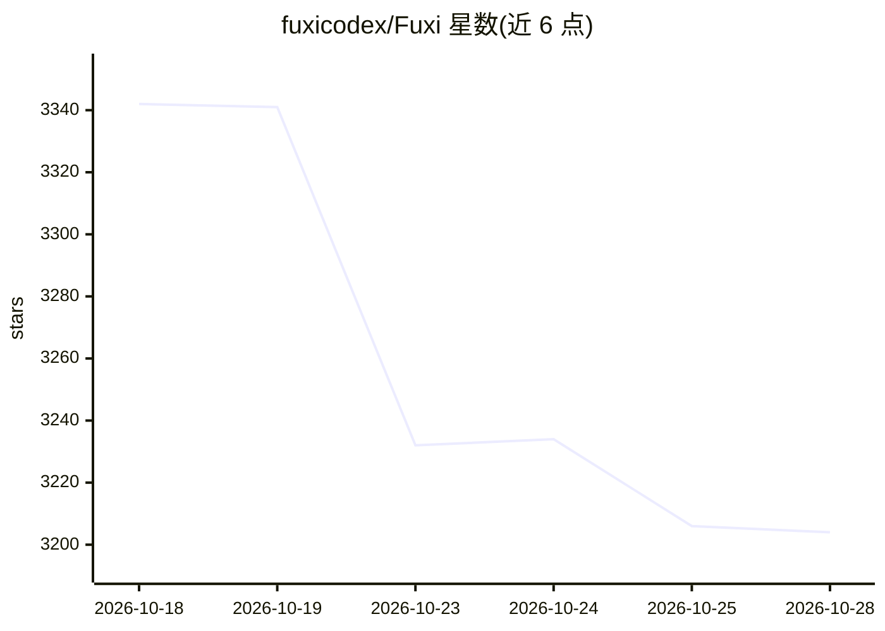

# fuxicodex/Fuxi

⭐ 3,204 · Python · NOASSERTION · 推送 2026-10-20 · [GitHub](https://github.com/fuxicodex/Fuxi) · [官网](https://www.fuxicode.com) · 组织维护 · 中文 README

**终端 AI 编程 agent：读码改码、跑命令、多模型路由**

Go 编写的终端 AI 编程 agent，以单一静态二进制分发、无运行时依赖。功能包括读写代码与编辑文件、运行命令、通过 MCP 接入工具，提供多 LLM 提供商的成本感知路由与自动故障转移。使用需注册 FuXi 账号登录；可用 FuXi 托管模型或自带 API key，代码与会话默认留在本地不上传。敏感工具调用默认需批准，支持 bypassPermissions 等权限模式。许可证为专有（Proprietary）。

## 筛选速览

| 维度 | 判定 | 备注 |
|---|---|---|
| AI 角色 | `ai-native` | 本体是模型或模型工具 |
| 许可风险 | `none` | NOASSERTION |
| 部署形态 | `None` |  |
| 模型依赖 | — | README 未给出锁定关系 |
| 硬件要求 | — | 无带数字的原话,不猜 |
| 安装摩擦 | `low` | 无编译、无系统依赖或容器化 |
| 成熟度 | — | 结构信号不足 |

## 能力要点

- Go 单一静态二进制，无运行时依赖，支持自更新
- 跨 LLM 提供商的成本感知路由与自动故障转移
- MCP 客户端，可在 TUI 中驱动工具与运行命令
- 代码与会话默认本地保存，凭据存于 ~/.fuxi/ 不上传

## 适用场景

- 在终端里让 AI 修复失败测试、编辑代码、执行命令
- 跨多个 LLM 提供商切换模型并控制成本
- 通过 MCP 接入外部工具扩展 agent 能力

## 场景标签

`编码 Agent` · 领域:编码与开发

## 证据(README 行号)

> L10: FuXi is a fast, self-contained **terminal AI coding agent**. It reads code, edits
> L11: files, runs commands, and drives tools from a rich TUI, with cost-aware routing

## 星数曲线

2026-10-18 3,342 → 2026-10-28 3,204（-138）

---
*卡片 v1 · prompt 1.4 · 生成 2026-10-20 · 置信度 high · 依据 README sha `b909af0c1a57` · [字段定义](../../DATASET.md)*
