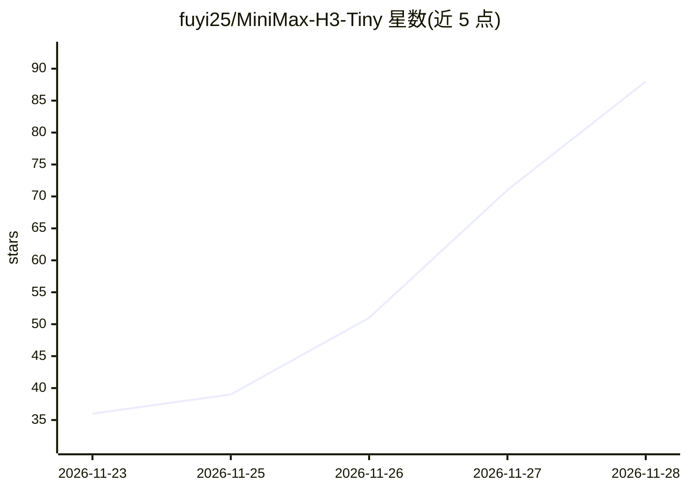

# fuyi25/MiniMax-H3-Tiny

⭐ 88 · Python · Apache-2.0 · 推送 2026-11-24 · [GitHub](https://github.com/fuyi25/MiniMax-H3-Tiny) · [官网](https://fuyi25.github.io/MiniMax-H3-Tiny/) · 个人维护

**MiniMax H3 结构化剪枝的 14B/17B 视频+音频生成模型**

对 MiniMax H3 Ref2VA（33B）进行结构化剪枝的模型发布与工具库：通过 AdaLN 低秩近似、块移除与 FFN 收窄将参数从 33B 压到 17B/14B，提供四个已发布检查点（含无训练剪枝、少步蒸馏与 OKD 恢复版本），支持文本+参考图联合生成视频与同步音频。附带剪枝脚本、推理脚本、diffusers pipeline、ComfyUI 单文件检查点与自定义节点。许可证分代码（Apache 2.0）与权重（MiniMax 社区许可）两部分。

## 筛选速览

| 维度 | 判定 | 备注 |
|---|---|---|
| AI 角色 | `ai-native` | 本体是模型或模型工具 |
| 许可风险 | `permissive` | Apache-2.0 |
| 部署形态 | `library` | 以包/库形式分发 |
| 模型依赖 | — | README 未给出锁定关系 |
| 硬件要求 | — | 无带数字的原话,不猜 |
| 安装摩擦 | `medium` | 含编译或系统依赖之一 |
| 成熟度 | — | 结构信号不足 |

## 能力要点

- 17B 检查点剪枝后无需训练即可使用，14B 经 33B 蒸馏恢复
- 少步检查点默认 6 步采样（最低 4 步）
- 每个检查点提供 ComfyUI 单文件 safetensors 版本
- 剪枝与推理代码开源，FL2VA/T2VA 工作流支持

## 适用场景

- 从文本和参考图生成带同步音频的视频
- 在 ComfyUI 中加载轻量版 H3 做视频生成
- 对 33B 原始模型自行执行结构化剪枝

## 场景标签

`视频生成` `模型量化` · 领域:内容生成

## 证据(README 行号)

> L15: Joint video + audio generation from text and reference images, at about half the size of the original, with recover
> L40: |`MiniMax-H3-Tiny-17B-Pruned-Ref2VA`|17.1B|AdaLN rank 8 + 8 of 50 blocks removed, **no training**|50 steps|✅|
> L98: The pipeline is the official diffusers MiniMax H3 workflow with the H3-Tiny transformer and step schedule

## 星数曲线

2026-11-23 36 → 2026-11-28 88（+52）

---
*卡片 v1 · prompt 1.4 · 生成 2026-11-23 · 置信度 high · 依据 README sha `cf33f72d0374` · [字段定义](../../DATASET.md)*
