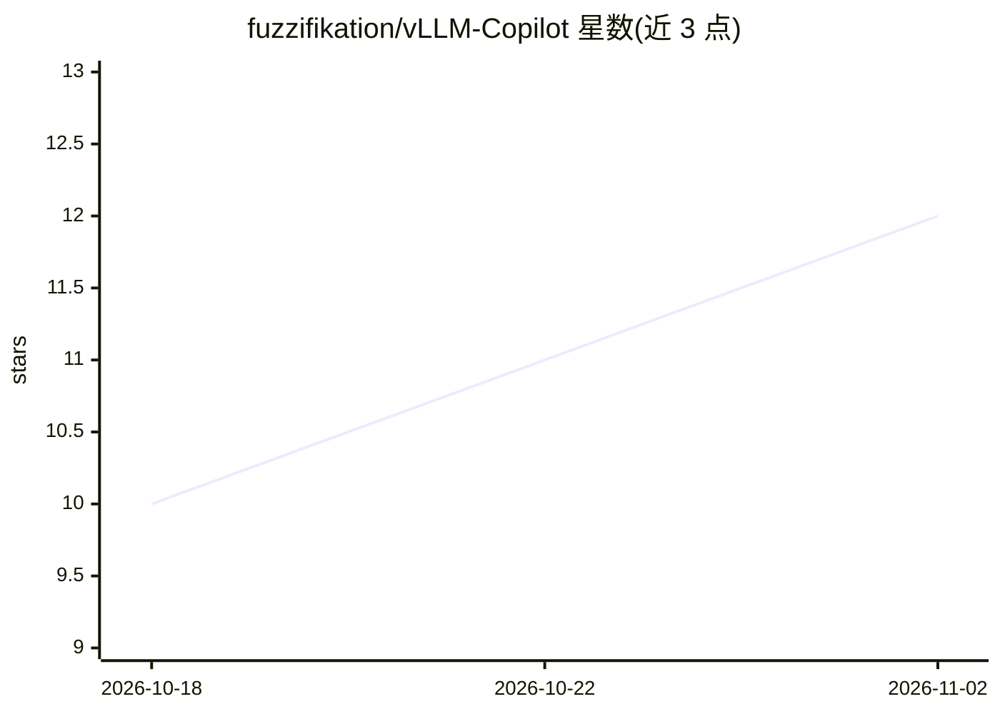

# fuzzifikation/vLLM-Copilot

⭐ 12 · TypeScript · NOASSERTION · 推送 2026-10-27 · [GitHub](https://github.com/fuzzifikation/vLLM-Copilot) · 个人维护

**把 vLLM 自托管模型接入 GitHub Copilot 的 VS Code 扩展**

面向在自有 vLLM 服务器上为多用户运行模型的团队，本扩展将模型接入 GitHub Copilot 聊天与 VS Code Agents 窗口：提供多服务器多用户管理、每模型独立的端点/鉴权/采样/令牌预算、model modes 命名配置切换、vLLM 可观测性仪表盘（KV-cache、TTFT、吞吐、成本追踪）。请求不发送到 GitHub Copilot 或 GitHub。同时兼容 OpenRouter（约 415 个云模型）、llama.cpp、LM Studio 和 Ollama。声明不提供安全护栏，许可为 MIT 源码 + BUSL-1.1 扩展双许可。

## 筛选速览

| 维度 | 判定 | 备注 |
|---|---|---|
| AI 角色 | `ai-ecosystem` | LLM/agent 周边工具 |
| 许可风险 | `permissive` | NOASSERTION |
| 部署形态 | `None` |  |
| 模型依赖 | local-ok | 支持本地模型 |
| 硬件要求 | — | 无带数字的原话,不猜 |
| 安装摩擦 | `low` | 无编译、无系统依赖或容器化 |
| 成熟度 | — | 结构信号不足 |

## 能力要点

- 在 Copilot 与 Agents 窗口中使用自托管 vLLM 模型，多服务器多用户
- 实时仪表盘：服务器可用性、队列、KV-cache、TTFT、吞吐与成本追踪
- model modes 支持任意 vLLM 请求参数与高级采样参数按模式切换
- 兼容 OpenRouter / llama.cpp / LM Studio / Ollama 后端

## 适用场景

- 团队用自有 vLLM 基础设施替换 Copilot 的模型来源，代码不经第三方
- 运维通过仪表盘监控多服务器模型使用量与成本
- 在 Copilot 内按模式切换推理/精确编码/创作等不同模型配置

## 场景标签

`LLM 可观测性` `模型网关` · 领域:Agent 开发

## 证据(README 行号)

> L8: **Your vLLM-served models inside GitHub Copilot and the VS Code Agents window.**
> L32: For teams running AI on their own vLLM servers for many users, this gives you the Copilot integration:
> L65: **Requirements:** GitHub Copilot Chat (you need a GitHub account, but no subscription), plus either a running model

## 星数曲线

2026-10-18 10 → 2026-11-02 12（+2）

---
*卡片 v1 · prompt 1.4 · 生成 2026-11-02 · 置信度 high · 依据 README sha `2399ad77bbfe` · [字段定义](../../DATASET.md)*
