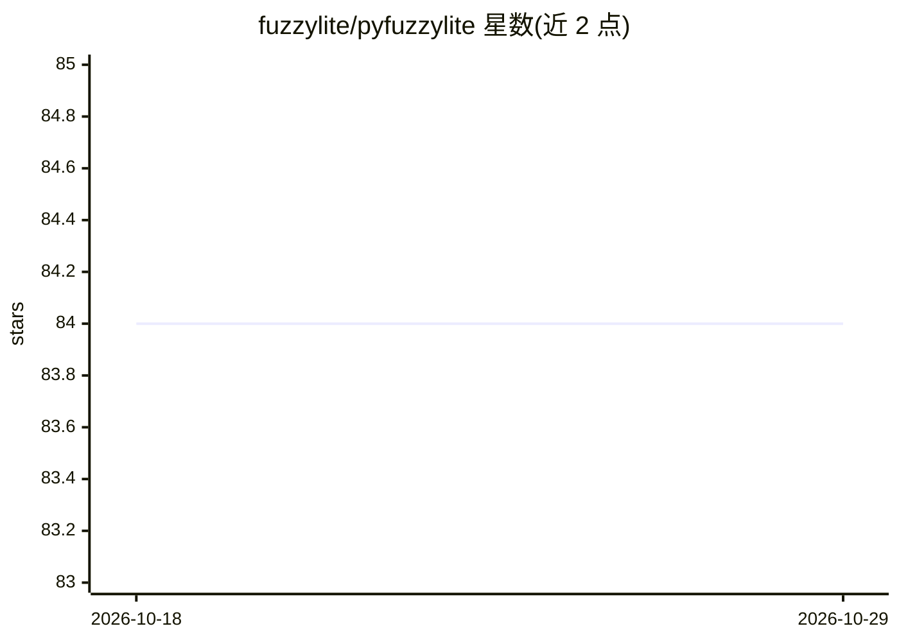

# fuzzylite/pyfuzzylite

⭐ 84 · Python · NOASSERTION · 推送 2026-04-02 · [GitHub](https://github.com/fuzzylite/pyfuzzylite) · [官网](https://fuzzylite.com) · 个人维护

**Python 模糊逻辑控制库：设计并运行模糊推理控制器**

面向控制系统的模糊逻辑推理库，提供 6 类控制器（Mamdani、Takagi-Sugeno 等）、25 种语言项、多种 T/S-范数、激活方法与去模糊化器，支持 FLL 导入及 Python/C++/R/FIS/FCL 等格式导出（部分需配合 fuzzylite C++ 库），内置 30+ 示例，支持 float 标量与向量化运算。以 pip 包交付，双许可：GPL v3 或商业付费授权。作者是 Juan Rada-Vilela, PhD。

## 筛选速览

| 维度 | 判定 | 备注 |
|---|---|---|
| AI 角色 | `ai-native` | 本体是模型或模型工具 |
| 许可风险 | `none` | NOASSERTION |
| 部署形态 | `library` | 以包/库形式分发 |
| 模型依赖 | — | README 未给出锁定关系 |
| 硬件要求 | — | 无带数字的原话,不猜 |
| 安装摩擦 | `low` | 无编译、无系统依赖或容器化 |
| 成熟度 | — | 结构信号不足 |

## 能力要点

- 6 类模糊控制器与 25 种语言项
- 9 种 T-范数、11 种 S-范数、7 种去模糊化器
- FLL 导入，Python/fll/fld 及（配合 fuzzylite）C++/Java/R/fis/fcl 导出
- 30+ 示例，支持 float 与向量化推理

## 适用场景

- 用 Python 构建与运行模糊逻辑控制器
- 导入/导出 FLL、FIS、FCL 格式与 Matlab/Octave 生态互通
- 模糊控制算法原型验证与教学

## 场景标签

 · 领域:控制/软计算

## 证据(README 行号)

> L3:  A Fuzzy Logic Control Library in Python
> L21: **The FuzzyLite Libraries for Fuzzy Logic Control** refer to `fuzzylite`
> L52: **(6) Controllers**: Mamdani, Takagi-Sugeno, Larsen, Tsukamoto, Inverse Tsukamoto, Hybrid

## 星数曲线

2026-10-18 84 → 2026-10-29 84（+0）

---
*卡片 v1 · prompt 1.4 · 生成 2026-10-24 · 置信度 high · 依据 README sha `98d1584e5c99` · [字段定义](../../DATASET.md)*
