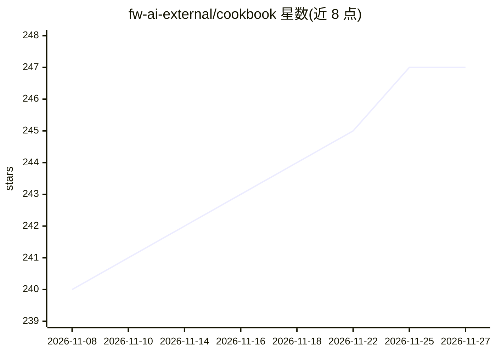

# fw-ai-external/cookbook

⭐ 247 · Python · Apache-2.0 · 推送 2026-11-26 · [GitHub](https://github.com/fw-ai-external/cookbook) · [官网](https://fireworks.ai/docs) · 组织维护

**Fireworks 平台上训练生成式 AI 的配方与资源库**

提供在 Fireworks 上进行 RL（GRPO、IGPO、SAO/PPO）、偏好优化（DPO、ORPO）、SFT、蒸馏与嵌入微调的训练循环代码与示例，通过 PyPI 发布 fireworks-training-cookbook 包，也支持源码检出。附带一套面向 AI agent 的技能（research/configure/debug/migrate-tinker），以渐进式加载方式将训练知识注入 Claude Code、Cursor、Codex 等兼容 agent，包含成本估算、训练运行监控与故障诊断等流程。案例研究（Advisor 代码评审、Voyage AI 检索）与 HealthBench Professional 评测独立于 PyPI 包。

## 筛选速览

| 维度 | 判定 | 备注 |
|---|---|---|
| AI 角色 | `ai-knowledge` | 知识聚合/清单类 |
| 许可风险 | `permissive` | Apache-2.0 |
| 部署形态 | `library` | 以包/库形式分发 |
| 模型依赖 | — | README 未给出锁定关系 |
| 硬件要求 | — | 无带数字的原话,不猜 |
| 安装摩擦 | `low` | 无编译、无系统依赖或容器化 |
| 成熟度 | — | 结构信号不足 |

## 能力要点

- 覆盖 GRPO/IGPO/PPO、DPO/ORPO、SFT、蒸馏、嵌入微调的逐文件训练配方
- 四类 agent 技能：research、configure、debug、migrate-tinker 工作流
- 支持 Claude Code、Cursor、Codex 三条技能安装路径，技能用可移植的 Agent Skills Markdown 编写
- 提供 HealthBench Professional 评测流程并导出经验证的 RL 轨迹

## 适用场景

- 在 Fireworks Training API 上配置并运行 SFT/DPO/RL 微调任务
- 诊断训练作业卡住、失败、缓慢或低质量的原因
- 将 Tinker SDK 的训练循环迁移到 Fireworks 原生客户端
- 为兼容 agent 安装训练领域技能以辅助决策与调试

## 场景标签

`微调` `强化学习` `教程课程` · 领域:学习与行业

## 证据(README 行号)

> L3: Training loops and worked examples for RL (GRPO, IGPO, SAO/PPO), preference
> L33: These skills bring Fireworks training know-how into compatible AI agents through

## 星数曲线

2026-11-08 240 → 2026-11-27 247（+7）

---
*卡片 v1 · prompt 1.4 · 生成 2026-11-27 · 置信度 mid · 依据 README sha `0ba047d01d6b` · [字段定义](../../DATASET.md)*
