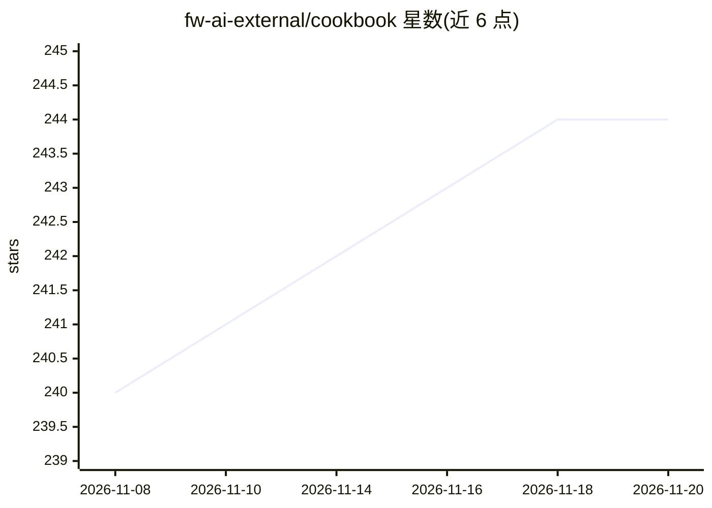

# fw-ai-external/cookbook

⭐ 244 · Python · Apache-2.0 · 推送 2026-11-19 · [GitHub](https://github.com/fw-ai-external/cookbook) · [官网](https://fireworks.ai/docs) · 组织维护

**Fireworks 平台的模型训练教程与示例代码集**

Fireworks AI 官方 cookbook：提供 RL（GRPO/IGPO/SAO/PPO）、偏好优化（DPO/ORPO）、SFT、蒸馏与嵌入微调的训练循环示例与可复用工具（config/data/losses/rollout/metrics），通过 PyPI 以 fireworks-training-cookbook 发布，Python 导入路径为 training.*，采用日历版本并独立于 fireworks-ai SDK 发布。另含面向 AI agent 的技能集（research/configure/debug/migrate-tinker 工作流），可装入 Claude Code、Cursor、Codex，以及推理应用案例研究和评测目录。

## 筛选速览

| 维度 | 判定 | 备注 |
|---|---|---|
| AI 角色 | `ai-knowledge` | 知识聚合/清单类 |
| 许可风险 | `permissive` | Apache-2.0 |
| 部署形态 | `library` | 以包/库形式分发 |
| 模型依赖 | — | README 未给出锁定关系 |
| 硬件要求 | — | 无带数字的原话,不猜 |
| 安装摩擦 | `low` | 无编译、无系统依赖或容器化 |
| 成熟度 | — | 结构信号不足 |

## 能力要点

- 覆盖 GRPO/IGPO/SAO/PPO、DPO/ORPO、SFT、蒸馏、嵌入微调的训练循环示例
- 以 fireworks-training-cookbook 包发布于 PyPI，导入路径 training.*
- 四个面向 agent 的工作流技能（research/configure/debug/migrate-tinker）
- 含 HealthBench Professional 评测与轨迹导出目录

## 适用场景

- 在 Fireworks 平台上学习并定制 RL/SFT/DPO 训练循环
- 通过 AI agent 辅助规划、调试训练任务
- 参考推理与检索应用的案例实现

## 场景标签

`教程课程` `强化学习` `微调` · 领域:学习与行业

## 证据(README 行号)

> L3: Training loops and worked examples for RL (GRPO, IGPO, SAO/PPO), preference
> L77: training/           Training API cookbook (primary surface)

## 星数曲线

2026-11-08 240 → 2026-11-20 244（+4）

---
*卡片 v1 · prompt 1.4 · 生成 2026-11-17 · 置信度 high · 依据 README sha `42c1e0a27746` · [字段定义](../../DATASET.md)*
