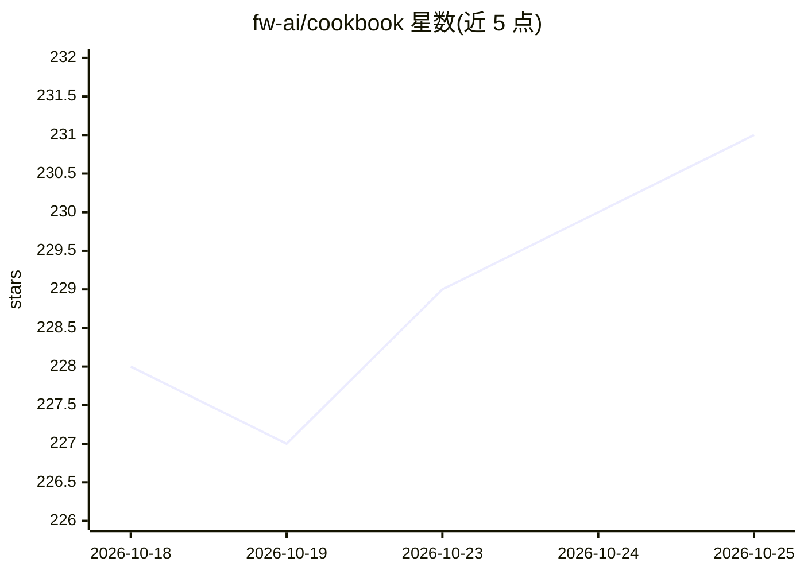

# fw-ai/cookbook

⭐ 231 · Python · Apache-2.0 · 推送 2026-10-24 · [GitHub](https://github.com/fw-ai/cookbook) · [官网](https://fireworks.ai/docs) · 组织维护

**Fireworks 平台训练教程与 agent 技能集：RL/DPO/SFT 等训练循环示例**

Fireworks AI 官方 cookbook 仓库：提供训练循环与示例，覆盖 RL（GRPO、IGPO、SAO/PPO）、偏好优化（DPO、ORPO）、SFT、蒸馏与嵌入微调，基于 Fireworks Training API。另含面向 AI agent 的三技能包（research/configure/debug），将 Fireworks 训练知识以 Agent Skills Markdown 形式接入 Claude Code、Cursor、Codex。还有通过 Harbor 运行 HealthBench Professional 并导出 RL 轨迹的评测模块。以 git clone 源码加 uv 安装训练包，或通过插件/技能命令安装技能。

## 筛选速览

| 维度 | 判定 | 备注 |
|---|---|---|
| AI 角色 | `ai-knowledge` | 知识聚合/清单类 |
| 许可风险 | `permissive` | Apache-2.0 |
| 部署形态 | `library` | 以包/库形式分发 |
| 模型依赖 | — | README 未给出锁定关系 |
| 硬件要求 | — | 无带数字的原话,不猜 |
| 安装摩擦 | `low` | 无编译、无系统依赖或容器化 |
| 成熟度 | — | 结构信号不足 |

## 能力要点

- 每文件一个训练循环的 recipes（RL/偏好优化/SFT/蒸馏/嵌入微调）
- research/configure/debug 三个 agent 技能，规划类技能在花费前请求批准
- 兼容 Claude Code / Cursor / Codex 的 Agent Skills Markdown 安装路径
- HealthBench Professional 评测轨迹导出用于 RL 工作流

## 适用场景

- 在 Fireworks 上做 SFT/DPO/RL 训练时参考可运行的循环代码
- 让 Claude Code/Cursor/Codex 里的 agent 规划或排查 Fireworks 训练任务
- 构建带行为策略 logprobs 的 RL 训练轨迹数据

## 场景标签

`教程课程` `微调` `强化学习` · 领域:学习与行业

## 证据(README 行号)

> L3: Training loops and worked examples for RL (GRPO, IGPO, SAO/PPO), preference
> L20: These skills bring Fireworks training know-how into compatible AI agents through

## 星数曲线

2026-10-18 228 → 2026-10-25 231（+3）

---
*卡片 v1 · prompt 1.4 · 生成 2026-10-22 · 置信度 high · 依据 README sha `794c89b81f57` · [字段定义](../../DATASET.md)*
